# Ash Enterprise

A reference Elixir/Ash application: a base template for enterprise software —
ERP, workflow management, line-of-business systems — with an opinionated answer
for every cross-cutting concern, and a repeatable process for growing the domain
model over time.

**The argument is in [`docs/manifesto/`](docs/manifesto/00-index.md). The code is
the evidence.** Several things here look unusual on purpose; the reasoning is
written down.

**The capstone is published:** a vet-clinic demo carved from this tree, showing
agents reading an Ash codebase instead of grepping it —
[`lukegalea/clinic-demo`](https://github.com/lukegalea/clinic-demo), with its
story and evidence index in [`docs/capstone/storyline.md`](docs/capstone/storyline.md).

## The thesis

> The cross-cutting concerns of enterprise software are declarable. Declare them
> once, derive them everywhere, and what is left over is the actual business.

Enterprise software is not hard because any one feature is hard. It is hard
because ownership, hierarchical access control, audit, versioning, multitenancy,
lifecycle and integration surfaces cross-cut *every* entity. Written per feature,
they decay. Declared once, they cannot.

## Every enterprise application answers the same questions

Not the same features — the same *questions*. Who owns this record; who may see it; what happened to
it and can you prove it; whose tenant is it; where did the data come from; how does the contract change
without breaking the callers you cannot see. Most systems answer them one feature at a time, and find
out in month nine which answers disagree.

This is the ledger. ✅ means built, covered by a named test, and running in a deployment we operate;
🟡 means it works with a limitation stated in the answer; 🔵 means a decision is written down and no
code exists; ⚪ means a gap with no decision taken.

<!-- roadmap:scoreboard:start -->
**16 of 54** enterprise questions have a shipped answer.

✅ Shipped 16 · 🟡 Partial 29 · 🔵 Planned 4 · ⚪ Open 5
<!-- roadmap:scoreboard:end -->

<!-- roadmap:sections:start -->
| Section | Shipped | Partial | Planned | Open |
|---|---|---|---|---|
| Who are you, and what may you do? | 5 | 5 | 0 | 0 |
| What happened, and can you prove it? | 6 | 5 | 0 | 0 |
| Whose data is it? | 2 | 3 | 0 | 1 |
| Where does data come from, and where does it go? | 1 | 3 | 3 | 2 |
| How does it change, and keep running? | 2 | 8 | 1 | 1 |
| Can you prove it, continuously? | 0 | 5 | 0 | 1 |
<!-- roadmap:sections:end -->

<details>
<summary><strong>The full ledger — click to expand</strong></summary>

<!-- roadmap:questions-summary:start -->
| # | Question | Our answer | Status |
|---|---|---|---|
| 1 | How do people prove who they are? | Password sign-in through `ash_authentication`, with remember-me, email confirmation and password reset; sign-in through the deployment's OpenID Connect identity provider when the build configures one (q29, ADR 0071); and API keys for the API and MCP pipelines. Sign-in issues a token that is stored server-side and expires after 8 hours (set explicitly, not the library's 14 days), the session cookie expires with it, and changing a password logs the user out everywhere. Five failed password sign-ins for one address lock it for 15 minutes, counted atomically in Postgres whether or not the address exists. The API and MCP pipelines read either an ordinary user token or a hashed API key from the bearer header; a key must carry an expiry (90 days at most), can be revoked, and stops working when its owner is deactivated. The unused magic-link route and its confirmation hook are removed. Not built: SAML and WebAuthn. OIDC sign-in is built and tested but not yet running in a deployment we operate. | 🟡 Partial |
| 2 | How is "may this actor do this?" decided? | `(role, privilege, depth)` rows evaluated as a pure union of grants — authorization is data, not code. No deny rules, so order cannot matter. | ✅ Shipped |
| 29 | How do enterprise customers bring their own identity provider? | One identity provider per deployment, over OpenID Connect (ADR 0071). The user resource declares an `oidc` strategy when the build sets `OIDC_BASE_URL`; the issuer, client and secret are read at runtime, and a build without them shows no provider button. A first sign-in links the provider's subject only to an existing user who is active, has confirmed the address here, and whose email the provider marks verified. An unknown address, an unverified email, an unconfirmed or deactivated user, a subject already linked to someone else and a second subject for one user are all refused, and no user is ever created. Each attempt is recorded at the `oidc` sign-in door without the email, and the provider's access and refresh tokens are not kept. The provider then owns the second factor, password policy and when a person leaves. Not built: SAML, a provider per organisation, and SCIM provisioning. Not yet running in a deployment we operate. | 🟡 Partial |
| 3 | Who owns a record? | Polymorphic user-or-team ownership inherited from the base resource. The Dataverse ownership type per entity is scraped from the corpus, never guessed. | ✅ Shipped |
| 30 | How do accounts appear and disappear when someone joins or leaves? | Joining and leaving are in-app actions today, and a directory does not drive them. Joining: registration creates a user with a confirmation email, and the seeder provisions confirmed users. Leaving: the platform lifecycle's `deactivate` action turns a user inactive. A deactivated user with the right password cannot sign in, a bearer token issued earlier stops authenticating and is revoked (reactivating does not revive it), a session subject no longer resolves, a password reset finds nobody inactive, an API key follows its owner, and the user is no longer a member of the tenant, so it loses its actions and its rows. Role grants can carry `valid_until` and are gone at that instant. The deactivation is recorded in each organization the person belongs to, and the `offboarding` pack (`priv/packs/offboarding/`, installed as drafts) matches it: once a person publishes it with `publish_granted`, its steps run as the recipe runner acting for them, revoke any session still live, archive the leaver's API keys so a reactivation does not revive them, record what the leaver holds there (owned records, open tasks, running processes, recipes, role assignments), and open a review for another administrator. A person reactivated before the run is not touched, and under a revoked or lapsed grant the run records `no_authority` and changes nothing (`test/ash_enterprise/accounts/offboarding_test.exs`). Role assignments are not ended by the recipe, because ending one changes authority and no automation principal does that: while the account is inactive they cannot act, and the review lists them for a person to end. What is missing: no directory is wired in, since there is no SCIM endpoint and `ash_scim` is not a dependency, so departure still depends on someone here being told. | 🟡 Partial |
| 31 | What second factor is required, and how are sessions bounded? | Sessions are bounded at the token, the cookie and the socket; the second factor is the identity provider's. The session token lives 8 hours, set explicitly (`Accounts.TokenPolicy`, host-configurable, a malformed setting raises rather than defaulting), is stored server-side so it can be revoked, and is revoked on deactivation and on a password change. The browser session cookie's max age is the same lifetime, and a LiveView connected before the token expired stops at its expiry rather than acting on. Before each event an open LiveView also checks, as a new request would, that its token is still stored and unrevoked and its user can still sign in, so deactivation or a password change stops it at its next event. Five failed password sign-ins lock an identity for 15 minutes. No in-app strategy requires a second factor: with sign-in through the deployment's OIDC provider (q29) the second factor and step-up are the provider's, and this application does not require the provider to assert one. | 🟡 Partial |
| 32 | Who may act as someone else, and is that recorded differently from acting as yourself? | Acting as someone else is gated, recorded and expiring. The record's `created_on_behalf_by_id` names the operator while `created_by_id` names the customer, and every audit event carries `impersonator_id`. A break-glass session names the operator, the person acted as, a written reason of at least 10 characters, a named approver and an expiry (240 minutes at most, host-configurable). Opening one is a request; it is live only after the named approver approves it, a separate audited act by an active person who is neither the operator nor the subject. Opening and approving need a grant and a human actor, never a system actor or an impersonating one. The session ends at its expiry instant, when ended, or when the operator or subject is deactivated. Not built: telling the account owner when a session opens. | ✅ Shipped |
| 4 | How does where you sit in the org chart change what you can see? | A business-unit tree with a materialized path, plus an optional manager/position hierarchy. Grant depth expands to a subtree once per request, never inside a policy check. | ✅ Shipped |
| 5 | Can one record be shared with someone the rules would not otherwise reach? | An `AccessGrant` row — Dataverse's `PrincipalObjectAccess` — adds rights to one record without widening any role. | ✅ Shipped |
| 6 | Are some columns more sensitive than the rows that contain them? | Yes, for reads, on the base resource and keyed by grants (ADR 0073). A resource lists `secured_fields`; reading one takes a role granting the column's own `:read` privilege (`prvReadCredential.number`), written into the catalogue at every boot, at a depth that reaches the row. A row grant does not include it, the Administrator holds every column, and there is no deny rule. Without the grant the value reads as hidden, and a filter or search on it matches nothing. The first secured column is a credential's licence number. `LinkedAccount` keeps its hand-written policy on `connection_id` beside it. Partial: a write to a secured column still follows the row's grant, and a sort on one is not rewritten. | 🟡 Partial |
| 10 | Can a deletion be undone? | A destroy archives the row instead of deleting it: `ash_archival` soft delete, inherited from the base resource, with an explicit `archival?: false` that a reviewer can grep for. A team can now be restored: `Team.restore` clears `archived_at` on a team archived within the restore window (30 days by default, `AshEnterprise.Platform.Validations.WithinRestoreWindow`), found through the `:archived` read. It is human-only and counted as changing authority, so no system actor, engine or automation principal reaches it; it needs write on teams; and the restore is audited with the person who did it. The refusals are tested: no write grant, a system actor, another tenant, outside the window, and a team never deleted. Partial because it is one resource: the other soft-deletable resources have no restore action, so undoing their deletion is still an operator's database operation. | 🟡 Partial |
| 11 | Can you rebuild state by replaying the log? | The `AshEvents` replay machinery is wired, and the clear step is now a configured list (`AshEnterprise.Audit.ClearRecordsForReplay`): it clears only the resources it names, and only where `allow?` is true, which dev and test set and production does not, so production still refuses. It also refuses before deleting anything when the log holds events of an audited resource the list does not name (replay re-runs every event), when events have moved to the archive (replay reads only the hot log), or when the list names the audit log or an unaudited resource. A test replays a log of business units created, nested and renamed, and gets back the same rows, and the replay records no new events. Partial because only that resource is proven: a full rebuild of every resource has not been run, and once retention has archived events the hot log alone cannot rebuild state. | 🟡 Partial |
| 33 | Can the audit log be altered after the fact? | Shipped. Two mechanisms with different jobs: a trigger refuses `UPDATE` and `DELETE` outright, and every event carries a SHA-256 chained to the previous one, so an operator privileged enough to drop the trigger still cannot make an edit look untouched. `mix ash_enterprise.audit.verify` walks the chains; the suite proves it by tampering. | ✅ Shipped |
| 34 | Can a customer see their own audit trail, and only theirs? | Shipped. The log is attribute-multitenant on an `organization_id` the chain trigger derives from stamped metadata, so a tenant-scoped read is filtered by the data layer rather than by a policy written specially for the audit log. Depth answers how much of a tenant you see; tenancy answers which tenant. | ✅ Shipped |
| 35 | Can an auditor be handed a window of evidence without engineering help? | Shipped. `mix ash_enterprise.audit.export --from --to [--tenant]` writes CSV in chain order, including `sequence`, `previous_hash` and `hash` so the recipient can re-verify it rather than take it on trust. It reads through the ordinary action layer, so an export is exactly as wide as its requester's authorization. | ✅ Shipped |
| 36 | How long is evidence kept, and where does it live after ninety days? | Ninety days hot, then archived; never purged before four hundred days from when it was recorded (`AshEnterprise.Audit.Retention`, daily). Audit events and superseded evidence artifacts older than ninety days move to `audit_event_archive` and `evidence_artifact_archive`, tables in the same database. Each move copies the rows, compares the copy (count, every column, a SHA-256 digest over the hashes, and each artifact's content against its hash) and deletes the hot rows only when that holds; a failed comparison deletes nothing and is recorded. One tenant's chain that cannot be verified is recorded as a failed run and does not stop the others, and a backlog larger than one run may move is reported and drains over the following runs. The immutability trigger allows a delete only of a row past ninety days with an identical archived copy, and the archive's triggers refuse every update and any delete under four hundred days, counted for evidence from the later of its stated collection time and when it was recorded, so a back-dated artifact is not purged early. Purging is off unless configured, refused under 400, and the chain still verifies across hot, archived and purged rows. Not partitioned: ADR 0024's partitions were never created, so the archive is tables, not detached partitions. Partial because expiry has not yet run in a deployment we operate, so no verified archive run is recorded outside the tests, and the archive is only as durable as the deployment's backups (q48). | 🟡 Partial |
| 37 | Are role and permission changes attributable to a person? | Shipped. Role assignments are ordinary audited resources, so granting one produces an event naming the grantor, the grantee and the correlation id of the request — and the record itself now carries `created_by_id`, which nothing populated before. | ✅ Shipped |
| 38 | Where are logs reviewed, and what raises an alarm on a declared audited event? | Alarms on declared audited events are raised in a tenant, and each leaves a record that a person reviewed it. The `security_alerts` pack (`priv/packs/security_alerts/`, installed as drafts), once a person publishes it, opens a review for an administrator other than the people involved when an Administrator or Platform Operator role is assigned, a break-glass session is approved, an API key is issued, a known person's sign-in is refused for the third time in a row, or a SigNoz alert labelled `security` arrives (a GlitchTip alert arrives as an error and never does). The reviewer's answer is the record that someone looked, and the event next to each alarm (another role, an unapproved session, a revoked key, two refusals, another alert category) opens nothing (`test/ash_enterprise/bpmn/alert_review_test.exs`). Inbound alerts come through a signed webhook (`POST /webhooks/alerts-signoz`, `/webhooks/alerts-glitchtip`): each key maps to one organization, and a replay or an unsigned, wrongly signed, stale or other-tenant call records nothing (`test/ash_enterprise_web/alert_webhook_test.exs`). SigNoz is the deployment's log review and alerting: every Ash action reaches it over OTLP as a span carrying the actor (ADR 0065), and the rules in `devenv/observability/security/alerts/` run on those spans across tenants, including refused sign-ins for addresses with no account. SigNoz is an observability platform, not a full SIEM: no detection-rule library, threat intelligence or cross-source correlation. Spans can be sampled and expire, so the tamper-evident audit log itself does not yet reach SigNoz (planned: committed audit events as OpenTelemetry log records). The rules notify nobody until a channel is set up, and neither tool signs a webhook, so their alerts reach the webhook only through a signing relay the owner supplies. Shipping to a customer's own SIEM is ADR 0025 (proposed). What is only logged: every other audited write (role revocations, privilege and posture changes, data changes, exports), refused sign-ins below the third, and every read, since reads are not audited. There is no review rota beyond these tasks, and the review proves that someone answered, not that the answer was right. | 🟡 Partial |
| 7 | Is every change recorded, including who and from where? | `AshEvents` writes a central append-only log on every create, update and destroy of a resource on the platform base, by default — inherited from the base resource, not wired per resource, so a new table cannot quietly have no history. A resource opts out only with `audit?: false` in its own file; among those that do are the append-only logs (model calls, agent run journals, the business-event ledger), read-only lookups and sync cursors. Who is recorded: the event names the acting user, and its metadata names a system actor, an automation principal and the person it acted for, or an impersonator, under a correlation id shared by every write of one request. Not recorded: where the change came from. No network address, user agent or client is captured, so a change can be tied to the request that made it but not to the place it was made from. | 🟡 Partial |
| 8 | Can you follow one request across the whole system at 3am? | One correlation id per request, stamped into audit metadata and OTel spans, and carried across process boundaries explicitly. | ✅ Shipped |
| 9 | Are illegal state transitions impossible, or merely discouraged? | `ash_state_machine` generates one named action per legal transition from the canonical Dataverse lifecycle. There is no generic `:update` that can set a state. | ✅ Shipped |
| 12 | How are tenants separated? | Attribute multitenancy on `organization_id`, inherited by every resource — never schema-per-tenant, and never per-department. | ✅ Shipped |
| 13 | Does tenant isolation hold even when authorization is wrong? | Yes, and it is asserted as a separate property: the conformance suite checks isolation independently of every grant path. | ✅ Shipped |
| 14 | Can you erase a person on request? | Partly, by crypto-shredding (ADR 0024's erasure half). Content that arrives through an external connection -- raw landings, canonical messages, conversations and calendar events, and the copies of that content in the audit log -- is sealed under that connection's erasure-scope key, and `shred_scope` destroys the key: rows, structural columns and the audit hash chain survive, the content reads as an explicit `shredded` marker. What is missing for a *person*: nothing yet lands under a `data_subject` scope, `Canonical.Person` names and emails are not sealed, core platform resources (users, organizations) are not covered, and soft delete is still the only delete. Backups and WAL keep the wrapped key until they age out. | 🟡 Partial |
| 15 | Where does the data physically live? | Partly. ADR 0042 declares zones: a jurisdiction, a classification ceiling and the residency restrictions a zone cannot satisfy. Data is admitted into a store only if its own tags are admissible there, and every unknown case (no zone, an untagged row, a malformed tag, a zone past its review date) is refused. The admission rule is built and used on the Gmail and Slack projection path. Nothing is declared by default, so a deployment that declares no zone fails closed; the rule is added per ingest action rather than inherited by every resource; and tenancy is still attribute-based in one database, so physical placement of the database itself is the deployment's. | 🟡 Partial |
| 39 | What crosses the tenant boundary, and to whom? | A design-time register of egress paths, generated into `docs/data-inventory.json` beside the inventory: one row per way data leaves the database (the provider proxy, guarded and judgment model calls, the assistant runtime, lineage events, account mail, trace export, the golden-record and audit exports, and every operation declared through `AshOperations`, read from its DSL). Each row names the class of recipient, the classes of data it can carry, and the gate that governs it, or says `none` with the gap in prose: the provider proxy and account mail have no tenant-level gate, and the guarded model path consults the deployment-wide in-zone flag but not the tenant's recorded opt-in. A test scans `lib/` for egress shapes and fails on a module that holds one and is in no row; it is a text scan with a known list of shapes, so a client library outside the list passes unseen. Not built: a list of a deployment's live sub-processors (the register names classes of recipient; the deployment owner records the actual vendors), a tenant-facing report, and an attestation of what a running deployment sent. | ⚪ Open |
| 40 | What does an AI model see, and can a customer opt out? | Partial. Thesis 5 settles the authorization half: an agent is an actor with an actor's permissions, so a model reaches nothing its user could not. ADR 0042 settles disclosure for inference: an instrument inside the data's own zone is not a disclosure and is recorded in the judgment ledger, and a sub-processor is refused unless the tenant has recorded an opt-in on its organization, which is data and is audited like any update. Every unknown case is a refusal, and `REQUIRE_IN_ZONE_MODELS` refuses sub-processors for everyone. The residency policy test asserts these. A model call's record (`AshEnterprise.AI.ModelCall`) holds its provider, model and usage, never its content, and an agent run's journal keeps the turns, sealed under the subject's erasure key (ADR 0056). ADR 0026 is still proposed, and there is no tenant-facing report of what a vendor saw. | 🟡 Partial |
| 16 | How does data get in from systems you do not own? | An Oban job runs a Meltano/Singer tap and lands raw rows in an operator-only landing resource sealed for erasure; host-declared projections promote them into ordinary platform resources, so ingested data acquires ownership, tenancy and audit at promotion. Provider APIs (Gmail, Calendar, Slack) land into the same resource through Nango. The schema-to-resource generator is not built. | 🟡 Partial |
| 17 | How do you integrate N SaaS systems without writing N×M integrations? | One contract per category rather than one per (your app × their API). Nango holds the provider edge — OAuth, token refresh, the proxy — and the sync logic stays here as Ash actions over Oban, so a policy gates which actor may trigger a sync and the ordinary audit log records it. Nango's free self-hosted edition gates syncs and webhooks, which is why the design is split that way rather than generated wholesale. Built for Google Calendar, Gmail and Slack (2026-10-12); webhooks are not. | 🟡 Partial |
| 18 | Can you trace a value back to the system it came from? | At the job and dataset level, yes. `ash_open_lineage` emits OpenLineage events from every platform write and every sync, and `AshEnterprise.Lineage` stores them as jobs, runs and job runs, drawn as a graph at `/app/lineage`. A run's id is the correlation id the audit log already carries, so the audit entries of a run and the run of an audit entry are each a lookup. Events carry names only, never an actor, a tenant or a value. Not built: tracing one value back to its source system. Neither Meltano nor Airbyte emits OpenLineage, so the graph has a hole exactly where external data enters, and that is stated rather than drawn over. Lineage rows are kept for 14 days. | 🟡 Partial |
| 19 | What data do you have, and who owns it? | A generated, read-only inventory of declared schema and ownership kind: `mix ash_enterprise.data_inventory` writes `docs/data-inventory.json` from the declarations every resource was compiled with, and CI fails when the file is stale. Each entry carries the domain, table, ownership kind, tenant-scoped or global, audit and archival switches, CDM provenance, API exposure, and which attributes are `sensitive?` or sealed. Classification is derived, never declared: a narrow name heuristic flags attributes that look personal, and one that is neither sensitive, sealed nor listed with a reason fails the check. It is a projection of the code, not a second source of truth, and it makes no claim of compatibility with any catalogue's schema. Not built: named data stewards (ownership here is a resource-level kind, which says who may be granted access, not who is accountable; accountable people are a deployment owner's input), a push to an external catalogue, and any attestation of what a running deployment holds. | 🔵 Planned |
| 20 | How do people get reports out of it? | Superset over views already filtered by the same actor context, so the BI tool's row-level security is a formality rather than a duplicate authorization model. Metabase loses because its RLS is paywalled. | 🔵 Planned |
| 21 | The same customer arrived from three systems — which one is real? | In-Ash resolution is built. Source records land with temporal history; deterministic and fuzzy matching are banded by a DMN table; a steward queue takes person-gated verdicts; and a merge picks a winner per attribute under the tenant's survivorship policy, which can rank sources (`source_rank`), records the provenance of each choice with the source and statement it came from, repoints the source identities and can be unmerged, all under one correlation id. The golden record is an ordinary platform resource, so it inherits ownership, tenancy, audit and policy. | ✅ Shipped |
| 41 | How do other systems find out that something happened here? | Open. Events land in the audit log and go nowhere else. There is no outbound webhook, no subscription, and no delivery guarantee for anyone who needs to react to a change rather than poll for it. | ⚪ Open |
| 42 | How does a customer get fifty thousand rows in, or out? | Open. JSON:API and GraphQL paginate, and neither is a bulk path. Import exists only as a Meltano-shaped plan; export exists only for the audit log. | ⚪ Open |
| 55 | How does production data reach an environment where the rules that protect it do not run? | A dump pipeline, not the action layer: greenmask transforms a pg_dump in flight, and its config is generated from the resource declarations by a proposed first-party extension — a `sensitive?` attribute with no declared transform fails generation rather than passing through, and referential continuity comes from greenmask's hash engine with an env-injected salt. The extension is built and public (`lukegalea/ash_greenmask`); this app has not adopted it yet. | 🔵 Planned |
| 22 | How do you move onto this platform from a database you cannot stop? | `ash_strangler` maps a well-modelled resource onto the legacy schema through a closed grammar of typed combinators whose reverses are built rather than guessed, and moves it through four cutover phases without hand-written SQL. **Running here**: `legacy.users` is read through a compatibility view as an ordinary platform resource, a durable change ledger drained by an Oban worker (with a five-minute sweep as the recovery net) keeps that surface live, the same change is *projected* into a table this application owns, and a nightly reconcile compares the view with that table by checksum over key ranges, repairs what disagrees and reports counts and key ranges (`docs/runbooks/legacy-migration.md`). That is moving onto the platform while the source keeps running: read, project, reconcile. Still partial, and deliberately: this is not a cutover, and it is one entity on the same database instance. The legacy database remains the system of record, and the mapping is not invertible in documented places (`full_name` cannot be split back into first and last, five legacy states collapse onto two lifecycle statuses, `company_id` is unmapped), which is exactly what a true cutover would have to resolve. | 🟡 Partial |
| 23 | How do the processes people actually follow get modelled? | `ash_bpmn` compiles a BPMN document into an immutable versioned graph and executes it with a token interpreter over Postgres and Oban, with an embedded designer. Gateway conditions are FEEL, the DMN expression language -- the hand-written expression evaluator it replaced is deleted. **Running here**: the six resources sit on the platform base resource, so a process instance is an ordinary owned, tenant-scoped record and the engine's bypass is the first policy in the base's own set. A published baseline, four seeded requests covering every branch of the gateway, and two tenants on different versions of the same key. | ✅ Shipped |
| 24 | How does an action get a second person's approval before it takes effect? | A change dropped on any action: work item, materialized candidate list, maker-checker exclusion applied by subtraction at candidate resolution rather than as a `forbid_if`, delegation, and escalation timers that get cancelled. **A work item is a platform resource here** -- owned, tenant-scoped and audited -- so who may approve is the same union of grants as who may read, and both the manager and executive approval branches are reachable in the demo. The refusals are now asserted, not only the positive case: a member who is not a candidate, a member whose role reads every task, a candidate for another task and another tenant's candidate are each refused and the task stays open. | 🟡 Partial |
| 25 | How do API contracts change without breaking the callers you cannot see? | Version deltas declared as data on the resource — one schema, N presentation contracts, no second table or view — with `render`/`parse` invertibility checked at compile time and sunset proposed from real traffic. | 🔵 Planned |
| 26 | How do you ship a change to some users first? | Through tenant feature flags (ADR 0072). A build declares its flags; each tenant decides who sees one with an audited, tenant-scoped row: off, on for everyone in the tenant, or targeted at named people, the members of named teams, the subtree of named business units, and a percentage of people by a bucket that is stable per person and key. The rows are resolved once per request (and before every LiveView event) into the person's `ActorContext`, so checking a flag is a set lookup that never queries, and a change reaches a person at their next request or event. An undeclared key is off; `FLAGS_OFF` kills a key in every tenant without touching a row. Flipping a flag is a person's act, needs a grant, and is in the audit log. Policies are not a substitute and never read a flag: they answer *may you*, not *is this on*, and conflating them produces a `beta_user` role you then have to revoke from everyone. Not provided: environments, percentage-of-time, scheduled flips and a management screen (flags are managed through the code interface and `mix ash_enterprise.flags`). Not yet running in a deployment we operate. | 🟡 Partial |
| 27 | How does the schema itself evolve without drifting from the model? | Migrations are derived as a diff against committed resource snapshots, and the diff is a CI gate — so a resource change without a migration fails the build rather than surfacing at deploy time. | ✅ Shipped |
| 28 | Can you tell what is happening in production? | Instrumentation is the `ash_enterprise_telemetry` package (`telemetry/`, on main): `AshEnterprise.Telemetry.setup/1` registers the Ash tracer, so every action, query and calculation becomes a span with no per-resource wiring, plus Phoenix, Ecto, Oban, outbound HTTP and GenAI spans, with correlation ids carried across them. The OTLP exporter is switched on by `OTEL_EXPORTER_OTLP_ENDPOINT` in `config/runtime.exs`; with it unset nothing is exported, and a bounded in-memory trace ring serves the dev loop. ADR 0065 chose the receiving end, SigNoz for traces, logs and metrics and GlitchTip for errors, superseding ADR 0018, and `devenv/observability` runs both beside the application in development. Not here: this host does not enable error reporting to GlitchTip, and no deployment we operate runs the backends, collects the signals or alerts on them. | 🟡 Partial |
| 43 | Can a deploy happen without downtime, and can a migration be reversed? | Partial. Every generated migration has a `down`, and `ash_strangler`'s four-phase cutover is built precisely so a legacy migration can be reversed at any phase. What is untested is the app's own rolling deploy: nothing proves an old and a new node can serve the same schema at once, which is the property zero-downtime actually needs. | 🟡 Partial |
| 44 | Does it still work for a customer with fifty thousand of something? | Built and measured on CI; not yet running in a deployment we operate, so the status waits for that. Every list read on a platform resource names a page size: a transformer gives each read that is not a get or a manual read a `default_limit` of 50 and a `max_page_size` of 250, so a page asked for without a limit gets 50 rows and no request gets more than 250, while an internal read that asks for no page still returns a list. The JSON:API index and the GraphQL list on business units, teams and positions serve a `:list` read whose paging is required, so a request that names no page gets 50 rows and a next link, never the table; a test walks every index route, list query and AI read tool and fails on one that could return a table. The `scale` CI job seeds 50,000 audited teams in one tenant: an unpaged JSON:API index, its next page and a GraphQL list each issue the same 12 queries at 1,000 rows and at 50,000 (at 50,000 rows the index and its next page took 83 ms each and the list 59 ms on a CI runner, against ceilings of three times the first CI measurement), and a business-unit-depth role's page is one query, on teams (25 ms). Seeding the 50,000 took 92 s. The numbers are the template's own seeded fixture on CI hardware, not any deployment's. Not measured at that size: writes, exports, the A2UI surfaces, the AI lookups that read a window before keeping their first rows, and every resource other than teams. | ⚪ Open |
| 45 | Can a customer change how it behaves without a deploy? | Partial, and less partial than it was. A tenant can fork a process or a decision, edit it in the browser and publish it as its own version, with no binding row meaning 'follow the platform baseline' -- so changing behaviour is data, and reverting is deleting a row. Drift from a newer baseline is reported, never merged. What is still a deploy: adding an attribute is a resource change and a migration, and a tenant can try a draft or published decision against sample inputs before publishing it (the Try it panel at `/app/decisions/:key/try`, which records nothing and is covered in `test/ash_enterprise_web/live/decisions/try_live_test.exs`). | 🟡 Partial |
| 53 | How are business rules expressed, versioned and changed without a deploy? | As DMN, in `ash_decisions`. A decision is a DMN document -- the single artifact, with no second copy of the rules in a table to drift from it -- versioned and immutable on publish, edited in dmn-js, and evaluated either by a business rule task inside a process or by trigger routing deciding which process to start. The engine is adopted rather than written and measured at 97.68% of the official DMN TCK. `OUTPUT ORDER` and `RULE ORDER` are refused at compile time because both make document order semantically significant, which is the same order-dependence the authorization model rejects. Publishing runs a verifier over every decision table: overlapping rules under `UNIQUE` or `ANY`, gaps in the input space and rules that can never fire are proved, an error-severity finding blocks the publish, and whatever the verifier cannot decide is recorded as an open obligation rather than reported clean. Every evaluation records which version decided, what it saw and which rules fired. An author can run any readable version against sample inputs before publishing, on the Try it panel at `/app/decisions/:key/try`: typed inputs, the answer, the rules that matched and the hit policy, with invalid input refused and no `Evaluation` written (`test/ash_enterprise_web/live/decisions/try_live_test.exs`; the version resolver is covered in `test/ash_enterprise/process/decision_resolver_test.exs`). What is missing is the panel inside the dmn-js editor itself, a way to try a platform baseline without customising it, and sample inputs saved with the draft. | 🟡 Partial |
| 54 | Can a UI built on the new model be driven by a database the old application still owns? | Yes, and it is demonstrated rather than asserted: `INSERT INTO legacy.users` in `psql` reaches a surface generated from `AshEnterprise.Accounts.ProjectedUser` -- an Ash-owned table with real columns -- without a reload and without anything in that surface knowing a legacy database exists. The chain is an `AFTER` trigger, `pg_notify` on commit, a durable ledger row written in the legacy transaction, a drain worker that upserts through an ordinary Ash action, and `Ash.Notifier.PubSub`. What it costs: the projection is eventually consistent, and `projected_at` is a column so the lag is on screen rather than hidden. A row that fails to project is retried by the drain (ten attempts, a five-minute sweep behind it), and a nightly reconcile compares the legacy view with the projected table, repairs disagreeing key ranges as the drain ingests a row (the same projection entry point and the KYC compliance events, in one transaction) and reports counts and key ranges; a projected row whose legacy row was hard-deleted is reported and never deleted. What is left: drift is telemetry only (no stored run record, no finding), and the scope is one entity on a same-instance schema with no cutover. | 🟡 Partial |
| 46 | Which named controls does any of this actually satisfy? | Partial. `docs/COMPLIANCE.md` maps 7 SOC 2 criteria, 4 ISO 27001 controls and 4 GDPR articles to the questions above and through them to the proof of each, generated from the same ledger so it cannot drift. `docs/controls.json` also carries an ownership row for each of the 61 SOC 2 criteria: a class, an owner role, and the evidence producer, operating process and test wherever one exists. 31 rows have nothing missing; 30 still lack a process, a test or a producer, and CI lists every missing piece (`mix ash_compliance.controls.check --report`) while a test refuses a reference that does not resolve. The 19 operator process templates `ash_compliance` ships each have one row in the `soc2` pack's map (`priv/packs/soc2/`): eight are recipes that open a human-only review (seven on a schedule, one on an inbound alert), four reuse a recipe or process the application already has, and seven carry the reason no audited event can start them; a test refuses a template with no row or two, an empty row or a recipe nothing uses. That closed 30 of the 101 missing pieces (71 remain). The pack installs as drafts and nothing runs until a person publishes it. A row says who owns a criterion, not that it operates; evidence is recorded only where a producer exists (the daily chain verification records CC4.1 and CC7.2), and every other criterion reads as unknown. An auditor can be handed the result: `mix ash_enterprise.audit.export --tenant --as --from --to --out` writes one tenant's audit package for a period, behind its own privilege (`read` on `AshEnterprise.Audit.Package`, global only): the criteria in scope with each one's control-file row, the evidence collected with each criterion's freshness at the period's end, the open findings, the review tasks and their outcomes, and the audit chain's verification, as plain JSON and as OSCAL 1.2.3 assessment results built by `ash_compliance`, whose suite validates them against NIST's published schema. It never reports a criterion as satisfied: unknown evidence is a not-satisfied finding, and the rest are observations. The map covers technical prerequisites only; certification also needs policy, process and an auditor, and the document says so first rather than last. | 🟡 Partial |
| 47 | What is promised about uptime, and what happens when it is missed? | Open: the template now says how uptime is expressed and measured, and the promise is still the owner's. `GET /health` answers without a sign-in and carries no data: 200 when the database and the job runner answer, 503 otherwise, the status, the version and each check (`test/ash_enterprise_web/health_test.exs`). A default objective is written down as SigNoz rules and a dashboard (`devenv/observability/slo/`): 99.5% of `/health` probes answered over 30 days, alerted on a fast and a slow error-budget burn and on no probe answered for 10 minutes, and p95 Ash action latency under 500 ms. Those numbers are unmeasured defaults, since nothing has run against them for 30 days. A missed objective is an alert, and an alert that reaches the application opens an incident (q49). What is the owner's: the prober that calls `/health`, the number actually promised to customers, a status page, and what a missed month costs. The SLI is measured where the application answers, so a node that answers nothing shows only as missing probes. | ⚪ Open |
| 48 | How quickly can you come back from losing the database? | A backup and restore drill exists and CI runs it on every push to main and to `ci/**` branches, and on every pull request: `scripts/backup-restore-drill` dumps the database with `pg_dump -Fc` from one snapshot, restores it into a fresh database, and checks the copy (every table's row count against the snapshot, every audit chain verified on the copy), reporting the dump's size, SHA-256 and how long the dump and restore took; a tampered chain or a missing row fails it. The `backup-restore-drill` CI job runs it against a seeded database on the service Postgres, and `docs/runbooks/backup-and-restore.md` is the procedure. Partial because it is measured at seed scale only and the drill is a script, not a named test. Nothing here configures where backups are stored, how often they run, point-in-time recovery or replication, and no RPO or RTO is committed to: those come from running the drill on a deployment's own data. | 🟡 Partial |
| 49 | When something breaks at three in the morning, what happens? | Partial: what happens is written down and built up to a task, and the rest is the owner's (`docs/runbooks/incident-response.md`). A SigNoz or GlitchTip alert that reaches the inbound alert webhook (q38) is recorded in the key's organization as an `alert.firing` occurrence and opens an incident there; a duplicate for the same rule joins the open incident instead of opening a second, and a resolved alert closes it. Once a person publishes the `incident_triage` pack (`priv/packs/incident_triage/`, installed as drafts, human tasks only), opening an incident gives the tenant's starter On-call role one triage task on the task list, which a person resolves or escalates to an administrator; a person not on call neither sees nor takes it, another tenant's alert opens nothing, and every step is in the audit chain (`test/ash_enterprise/bpmn/incident_triage_pack_test.exs`, and end to end through the webhook in `test/ash_enterprise_web/incident_webhook_test.exs`). Still missing: neither tool signs a webhook, so a relay that holds the key is the owner's; the task list wakes nobody; and the rota, a pager and what the customer is told are the owner's. | 🟡 Partial |
| 50 | What is in the build, and can you prove nothing else is? | Partial. CI runs `mix hex.audit` for retired packages and `mix sobelow` for web vulnerabilities on every push, `mix.lock` pins everything transitively, the Dockerfile pins Elixir, OTP and the base image, and a test fails when a git dependency or an override is missing from `docs/BLEEDING-EDGE.md`. CI has no schedule, so a vulnerability published after the last push is not seen, and no dependency update service is configured. There is no SBOM, no signed build and no provenance attestation, so the dependency set is checked but not attested. | 🟡 Partial |
| 51 | Can you show a control operated continuously for twelve months? | Partial. This is the question the rest of the section is really asking. What exists: an unbroken, verifiable hash chain covering every write, exportable per tenant for any window, and an ownership row for each SOC 2 criterion in `docs/controls.json`. Now scheduled: every chain, hot and archived, is verified daily and the result stored as an evidence artifact for CC4.1 and CC7.2, findings included (`AshEnterprise.Audit.ChainVerifyWorker`), and `ash_compliance`'s freshness sweep runs hourly for every organization, so a daily control whose last result is older than a day becomes an open `:unknown` finding, and is resolved when fresh evidence arrives. Retention keeps the window: ninety days hot, nothing purged before four hundred (q36). The audit package (`mix ash_enterprise.audit.export`, q46) hands an auditor any period of it for one tenant: how many daily verifications were recorded, every artifact with its hash re-checked, each criterion's freshness at the period's end, and the chain verified whole, hot and archived; a chain that does not verify is reported as broken, in the JSON and as an OSCAL finding, never passed over. Still missing: twelve months of it actually running, most criteria having no producer recording evidence at all (they read as unknown), and any evidence that anyone reviewed the log (q38). | 🟡 Partial |
<!-- roadmap:questions-summary:end -->

</details>

The long form, with what each answer is proven by, is [`docs/QUESTIONS.md`](docs/QUESTIONS.md). The ⚪
rows are argued at length in [thesis 7](docs/manifesto/07-what-we-do-not-have.md).

## Getting started

```bash
devenv up -d                            # Postgres (with pgvector)
devenv shell -- mix setup               # deps, database, migrations
devenv shell -- mix ash_enterprise.seed # a tenant, a role, a user
devenv shell -- mix ash_enterprise.demo # the demo tenant: a business-unit tree, people, a clinic
devenv shell -- iex-server              # the app
```

**Nothing to configure for dev or test.** Both boot with built-in session and LiveView
signing salts (`config/dev.exs`, `config/test.exs`), so the commands above are the
whole first run. Those values are public. **Every other environment** (a production
release, or anything that runs `config/runtime.exs` in `:prod`) must set its own
`SESSION_SIGNING_SALT` and `LIVE_VIEW_SIGNING_SALT`, at least 32 characters each and
different from each other. The release refuses to boot, with a message naming the
variable, when one is missing, short, repeated or one of the built-in dev/test
values. Generate each with `mix phx.gen.secret 32`. Names only are listed in
[`.env.example`](.env.example).

**Starting a new application from this template?** Read
[`docs/BLEEDING-EDGE.md`](docs/BLEEDING-EDGE.md) first. Two dependencies are forks of
upstream packages, and 13 of our own packages are not on Hex yet. That page
says which, why, and the path back to a Hex release for each.

`seed` provisions the minimum — one organization, one business unit, one
administrator — which is what tests want and what a first run needs. `demo`
creates a tenant of its own (`clinic-demo`, administrator `demo-admin@example.com`) and fills it,
touching no other tenant, so it is safe on a database that holds real ones. Most of what this platform argues for is invisible against
a single row: grant depth needs a subtree to be measured over, and policies that
differ per actor need a second actor. Everything it creates goes through the
application's own actions, so the people it adds can sign in. Their password is the fixed
`password1234`, which only dev and test allow: in any other environment `seed` and `demo`
refuse to run without `--password-file PATH`. On an instance other people can reach, pass it
whatever the environment: the people get the password in that file, a random one is written
there (mode 0600) when it does not exist, and it is never printed. A re-run does not reset the
password of a person who already exists.

Sign in with the credentials the seeder prints, then visit:

| URL | What |
|---|---|
| `/app` | The launcher — every surface in the registry (`AshEnterprise.Surfaces`), grouped, Today leading; sign-in lands here (`/app/hub` and `/app/demo` redirect here) |
| `/app/mdm/import` | **MDM demo: import a customer CSV** (upload → AI-proposed mapping → activate → run) |
| `/app/mdm` | **MDM demo: steward queue** — side-by-side diffs awaiting confirm / reject / unsure (reject also in bulk) |
| `/app/mdm/golden` | **MDM demo: golden records** after the confirm, with their source identities and merge history |
| `/app/mdm/batches` | **MDM demo: import batches** as a board by status, each with its counts and staged rows |
| `/app/tasks` | Every process task waiting on you, as a board: claim, complete, delegate |
| `/app/processes` | The `mdm.steward_review` BPMN process the review candidates run (banding itself is a DMN table) |
| `/app/flights/stewardship`, `/app/flights/briefs` | Flight views: a process diagram with a marker on the step each run is on, moved live as the engine advances; `/app/flights` shows one run |
| `/agent` | Helper console — proposes changes for your approval, and shows or composes tables on request |
| `/app/users`, `/app/teams`, `/app/roles`, `/app/business-units` | A2UI surfaces derived from resource metadata |
| `/app/legacy-users` | The same, over a 2010-era Rails schema read through a compatibility view — and it updates when the old application writes |
| `/admin` | Zero-config admin over every resource (dev only) |
| `/canvas` | The domains, resources and relationships as one object graph, with the selected resource's surface beneath it (dev only) |
| `/clarity` | ER, class, policy and state-machine diagrams (dev only) |
| `/api/json/swaggerui` · `/gql/playground` | Interactive explorers for JSON:API (OpenAPI) and GraphQL (dev only; a release serves the APIs and `/api/json/open_api`, not the explorers) |

**The MDM demo, end to end** (fresh DB): sign in as `demo-admin@example.com` /
`password1234` (or the password in your `--password-file`) — the demo tenant owns the demo data.

1. `mix ash_enterprise.demo` seeds the machinery and one in-flight import:
   a golden "Ann Existing" with a merged duplicate, and a review-banded
   match waiting at `/app/mdm`.
2. Upload any CSV at `/app/mdm/import`, click **AI proposal**, review the
   column mapping, **Validate & activate**, then **Run import**.
3. Low-confidence matches land at `/app/mdm`: **Confirm match** merges the
   staged record into its golden; **Reject match** keeps it a separate
   person (several at once, from a selection); **Mark unsure** records the
   verdict and leaves it open for a senior steward.
4. `/app/mdm/golden` shows the survivors and `/app/mdm/batches` the import
   itself; the screens link to each other.

The seeded review candidate is consumed once decided — re-run
`mix ash_enterprise.demo` to reseed one (it is idempotent otherwise).

## What it looks like

No markup was written for any of this. Every surface here is derived from the
same resource definitions: the screenshots are what you get for declaring a
resource, before writing any UI.

**The launcher** at `/app` is the shortest path through all of it, and the
place to start after seeding. It, the nav and the ACP command palette are all
derived from one surface registry, `AshEnterprise.Surfaces`.

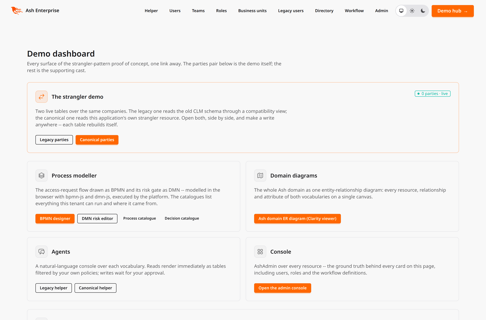

**A2UI surfaces.** One page per resource, rendered from resource metadata. The
grid, the filter and the tasks are all derived; the actor and the tenant are the
only things the LiveView supplies, so each surface is filtered by exactly the
policies that guard the API.

What a surface offers is derived too, from the actions that exist. A resource
with an update action gets `Edit` on the row; one without gets `View` alone —
which is why `/app/legacy-users` below is read-only without anything in this
application saying so, the strangler read model having declared `defaults [:read]`
and nothing else. Pagination appears when there is another page to go to. A form
appears when you start a task, headed with which task it is, and its button says
what it will do.

What *is* declared is a dozen lines of layout intent per surface — which field is
the title, which is the status badge, what belongs in the metadata grid — because
a derived screen still has to be told what matters. Nothing in that declaration
is styling; A2UI's components carry no spacing or colour props at all, in any
version of the spec. Appearance comes from a CSS custom-property contract that
`assets/css/neobrutalism.css` maps onto the app's design tokens, so these pages
follow the same theme and the same dark/light toggle as the rest of the app
([ADR 0050](docs/adr/0050-neobrutalism-design-system.md)).

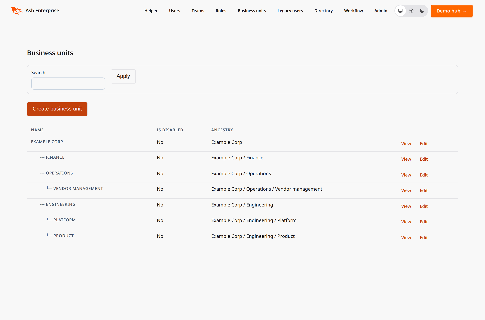

The same generator, three more resources — users, teams and security roles:

| Users | Teams | Roles |
|---|---|---|
| 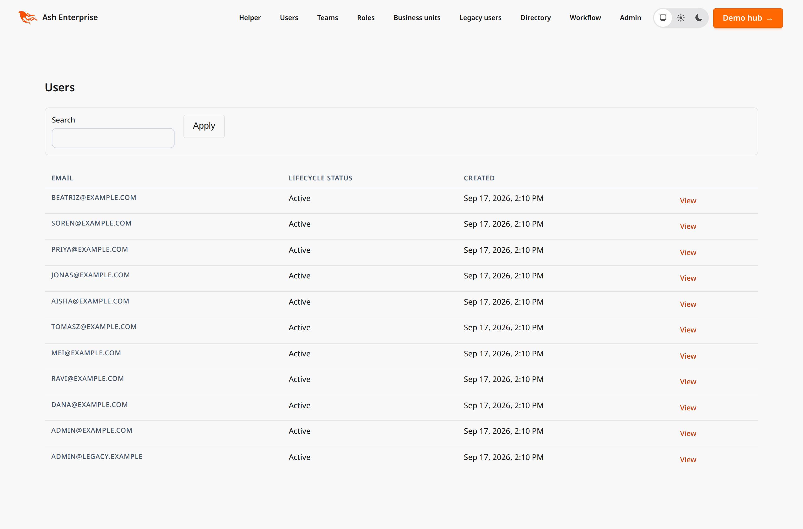 | 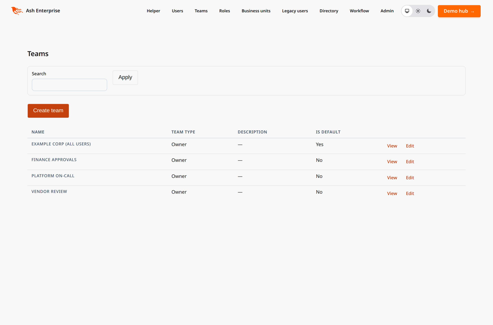 | 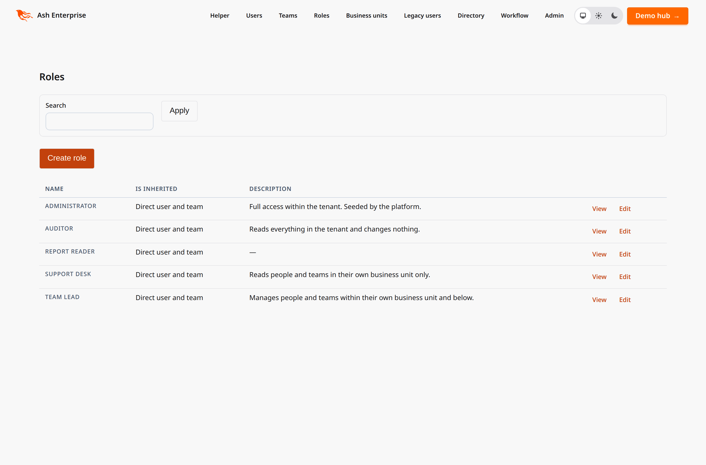 |

**The helper console.** Ask for an administrative change in plain language. The
model plans and returns a struct; it never holds the mutation, so there is no
tool for a prompt injection to reach.

Here it has interpreted *"Give dana@example.com the Auditor role"*. The names are
resolved **as you**, against records you are allowed to see — so a user you
cannot read comes back as "not found" rather than as a proposal referencing a
record you have no business knowing exists. Authorization is checked before this
card is rendered, so you are never asked to confirm something that will then
fail.

Approving executes it *as you*, through the same policies as the admin UI. The
audit row names the human who approved, not the model that suggested.

Interpreting a request needs a provider key. Everything after it — resolution,
authorization, execution, audit — is ordinary Ash code and does not, which is why
the flow is exercised end to end by the test suite without one.

Not every request is a change, and treating one as if it were is how people learn
to click past confirmations. Asked for a table, the console renders one of the
surfaces the application already declares — filtered by your policies before a
single row reaches the page, so there is nothing to confirm:

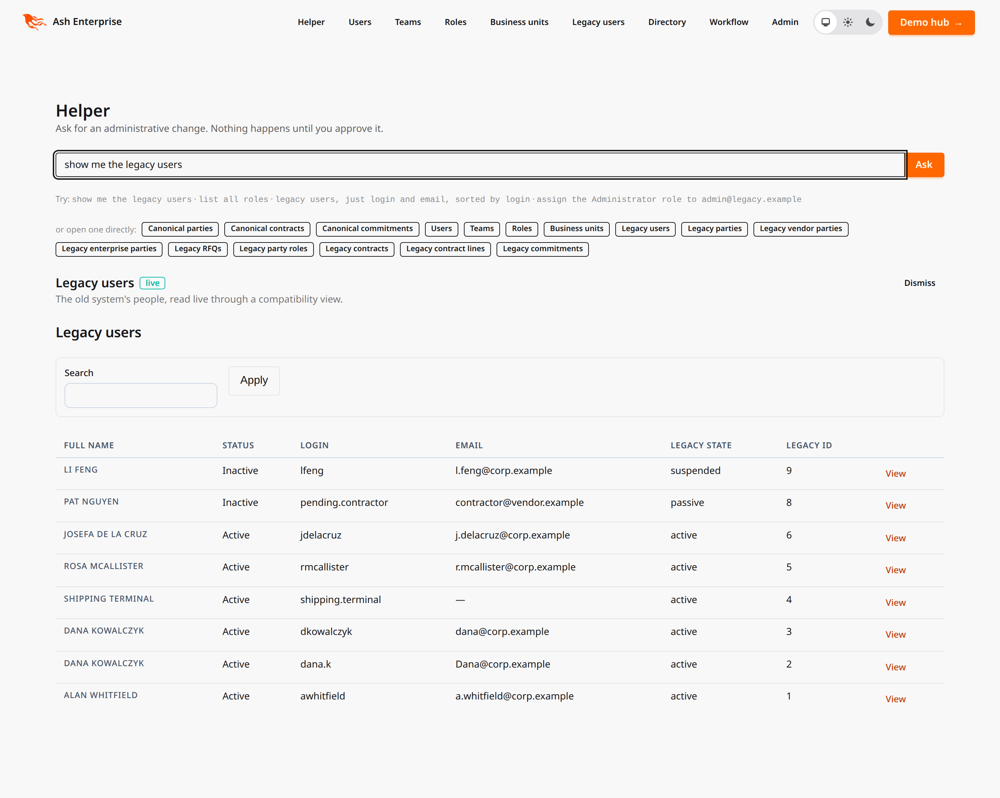

When no declared surface fits, it composes one. What the model returns is a
**spec**, not UI: a resource name, field names, a sort. The server resolves every
name against a host-configured allowlist and runs the same verifiers the
compile-time DSL runs, so a spec naming a field that does not exist is refused
with an error rather than rendered blank:

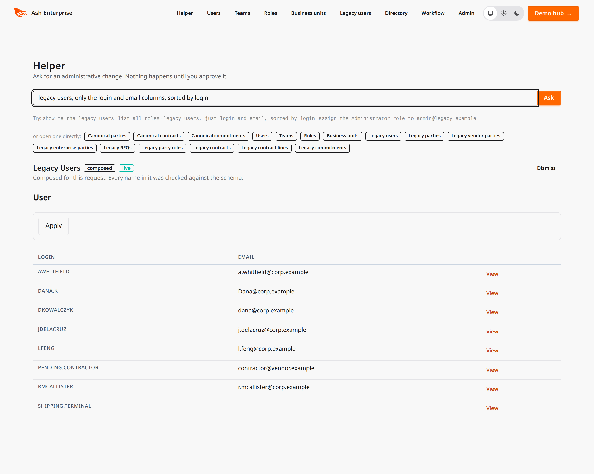

**A legacy write, showing up.** `legacy.users` is a simulated 2010-era Rails
schema this application does not own — `serial` primary key, no tenant column,
`acts_as_paranoid`, SHA1 passwords. One `ash_strangler` mapping turns it into an
ordinary resource here *and* emits an `AFTER` trigger that `pg_notify`s on
commit. A listener re-reads the row through Ash and dispatches a real
notification, so nothing downstream can tell which application wrote it:

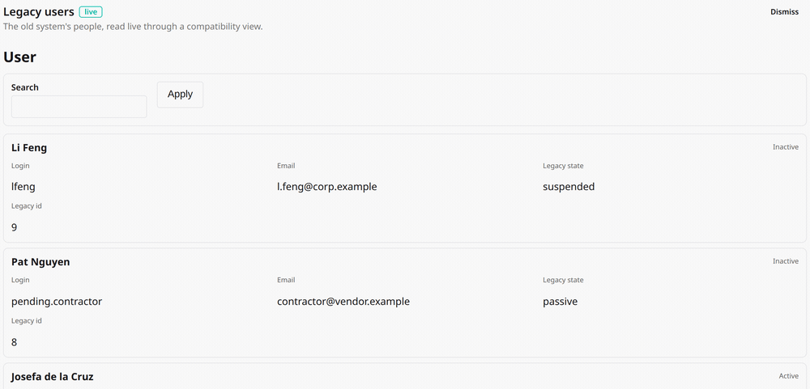

Nothing there is staged: the row arrives from a plain `INSERT INTO legacy.users`
issued with `psql` — no Ash, no changeset, no HTTP request. See
[`priv/legacy/README.md`](priv/legacy/README.md) for the commands.

**Master data, end to end.** `/app/mdm/import` → `/app/mdm` → `/app/mdm/golden`
is the entity-resolution loop the ADR 0054 plan asked for, driven entirely
through the UI. Upload a CSV, let the AI propose the mapping (activation stays
a person's act), run the batch, and review-banded matches wait in the steward
queue as side-by-side diffs with survivorship winners:

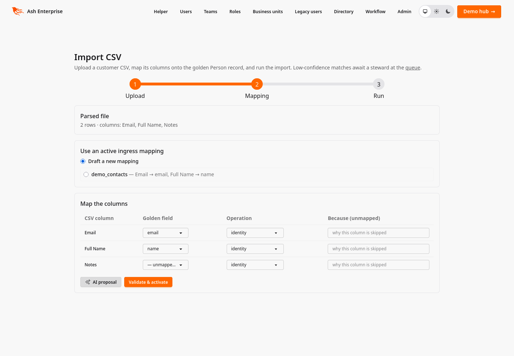

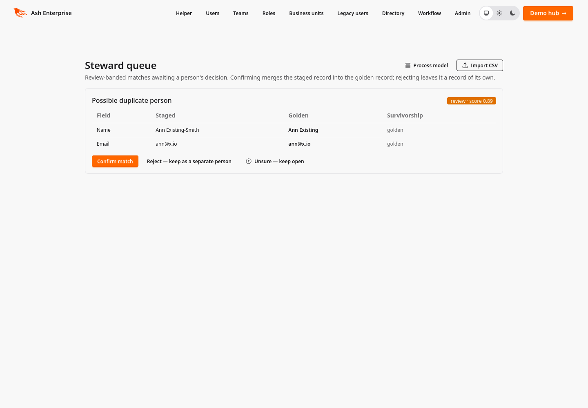

Confirming merges the staged record into its golden; the golden surface lists
the survivors, with the merge lineage itself answerable as data (`merged`,
`master_id`, the `SourceIdentity` XREF) rather than drawn:

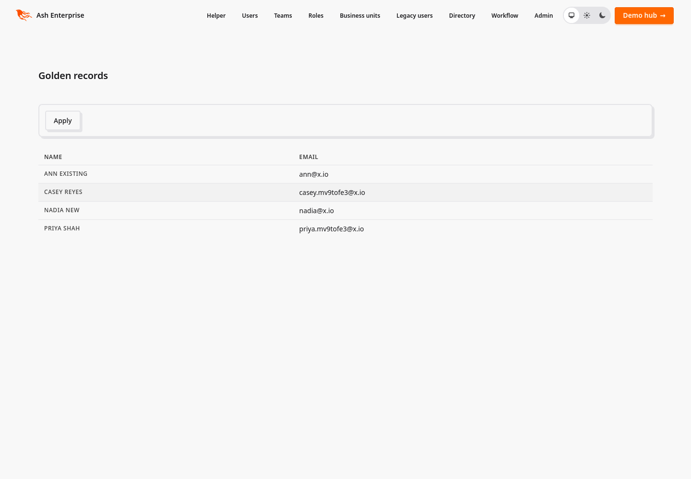

**The object graph.** `/canvas` is the application's own structure: every domain,
every resource, and the relationships between them, derived from Ash metadata
alone. No record is ever a node — the graph is declared structure, not a query,
so opening it reads nothing.

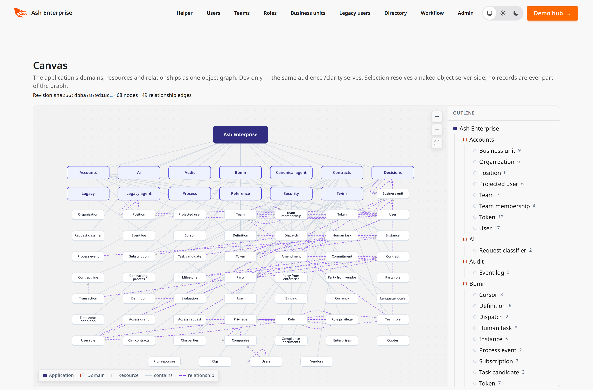

Selecting a node resolves it server-side into a *naked object*: what it is,
where it came from, one `Ash.can?/3` per action with your actor, and the
*projections* it offers — the ways this application can show it. The graph
focuses on the selection and its immediate neighbours, and the object's own
A2UI surface opens underneath, so the thing you just pointed at is also the
thing you can now browse and edit.

Projections are where the object model stops being a diagram of the database.
Most are derived from the actions a resource declares — a read makes it
browsable, an update makes it editable — but some cannot be. A BPMN process
definition and a business unit have indistinguishable actions; what differs is
that this application ships bpmn-js and points it at one of them, which is a
fact about the host rather than the resource. So the host declares those
([ADR 0037](docs/adr/0037-projections-are-host-declared.md)), and every
projection that has somewhere to go renders as a link beside it. A process
definition offers `diagram` and opens in the modeller; approvals open in the
task list. None of those pages is a derived table, and until they were reachable
this way the whole process layer sat in the graph as objects with nowhere to go.

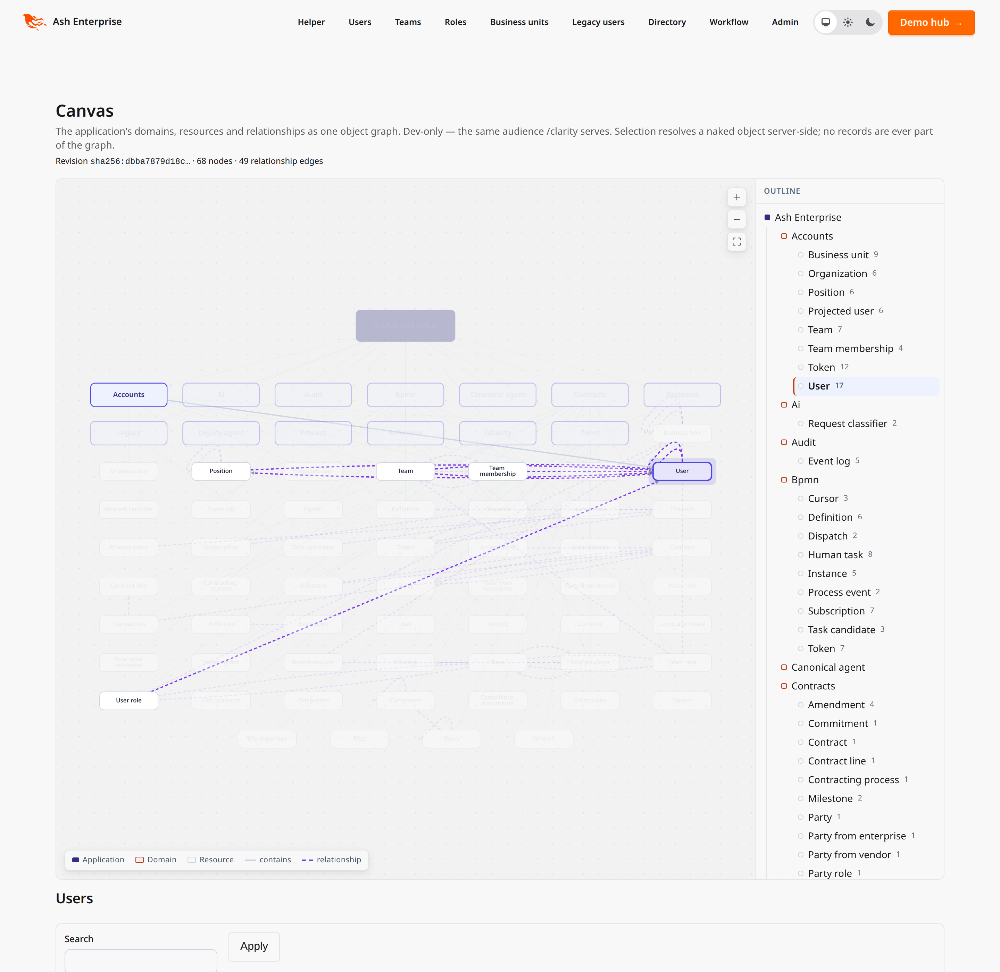

It is dev-only, behind the same flag as `/clarity`, and serves the same
audience.

**AshAdmin.** Every resource, every action, no configuration.

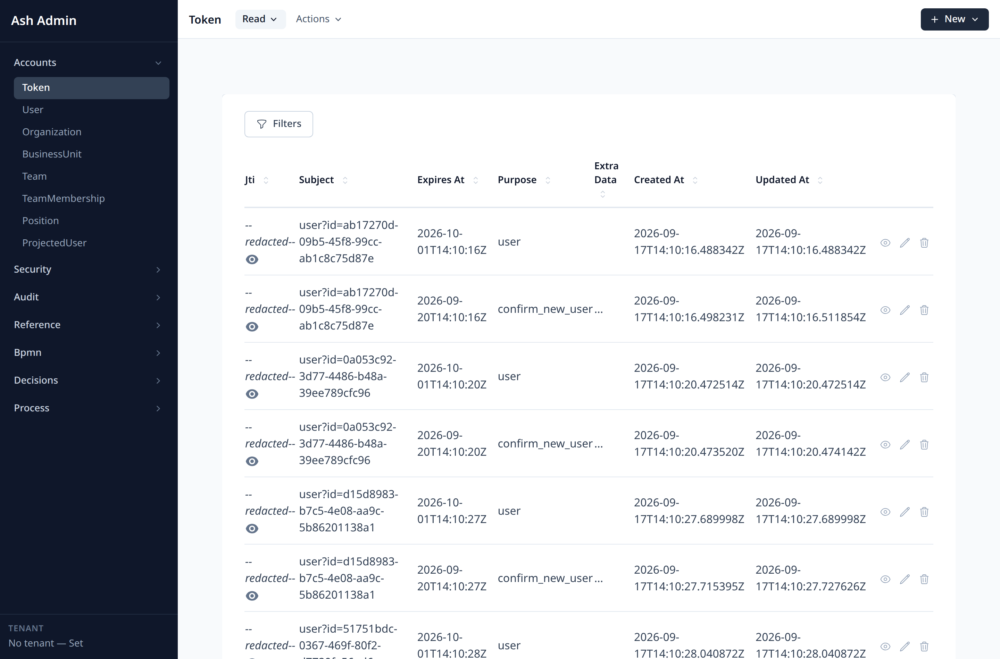

**GraphQL.** The schema — types, filter inputs, sort inputs, pagination — is
generated from the resources that opt into an `api_type`. Nothing in the list
below was hand-written.

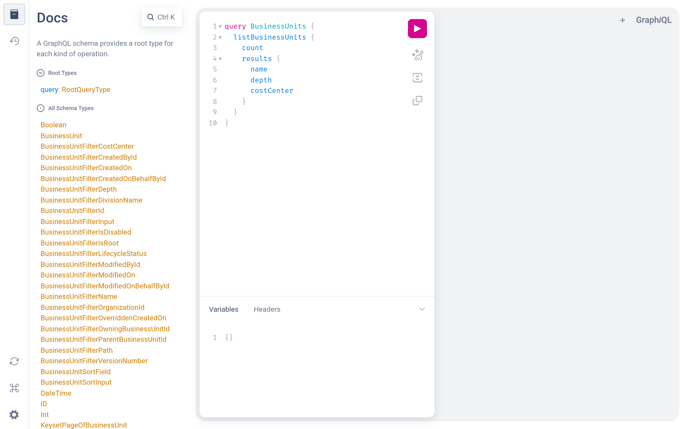

## What is here

**A platform layer.** `AshEnterprise.Platform.Resource` is the base resource
every resource uses. Ownership, provenance, lifecycle, concurrency, tenancy,
audit, soft delete, telemetry and authorization arrive by inheritance — not by
per-resource discipline.

**Authorization as data.** A faithful implementation of the Dataverse security
model: `(role, privilege, depth)` rows evaluated as a **pure union of grants**,
with business-unit hierarchy, per-record sharing, and manager/position hierarchy.
`test/ash_enterprise/security/conformance_test.exs` is the truth table, and it is
the first thing to read when the model surprises you.

**A schema commons.** Entities derived from the Microsoft Common Data Model —
vendored at a pinned commit, resolved offline, committed as flat JSON. 43 CDM
entities plus 18 from the Dataverse table reference. Do not invent your nouns.

**Agents as first-class users.** The same Ash actions and policies back the web
UI, JSON:API, GraphQL and MCP. An LLM tool is a *declaration that an existing
action may be invoked*, not a parallel code path — which is why there is no
agent-specific authorization, and therefore no agent-specific authorization bug.

## Compliance engine

Compliance is **projected from events under an immutable rule bundle**
([ADR 0035](docs/adr/0035-compliance-is-projected-from-events.md)). Three
first-party packages carry it; this application wires them into one vertical
slice, customer KYC:

* **`ash_rules`** — the rule engine seam: a serializable rule IR, a
  fact-schema DSL, and evaluator behaviour. Rules are data with verifiers at
  admission, never quoted code.
* **`ash_compliance`** — the control plane and the data plane. Catalogs,
  profiles, waivers and rule-set revisions compile — through a fixed,
  non-negotiable layering precedence — into immutable, content-hashed
  `PolicyBundle` snapshots; findings project out of a compliance event log,
  and every evaluation is appended, pinning the bundle hash, the fact
  snapshot and the outcome. Missing evidence is `unknown`, never compliant.
* **`ash_strangler` (ledger)** — the change ledger the legacy trigger writes,
  and the drain that turns a legacy write into a canonical projection plus a
  KYC review in one transaction, attributed to the projection system actor.

The chain, end to end: **legacy write → ledger row → drain → canonical action
→ event → projector → finding.** The subject reads its own state back as
ordinary calculations (`kyc_status`, `compliant?`, `gap_count` on
`ProjectedUser`); auditors read the evaluation log, which no code path rewrites.

Run the demo program for the legacy estate's tenant:

```bash
mix ash_enterprise.compliance.seed   # catalog, layers, profile, one bounded waiver, active bundle
```

The admin surfaces live at `/app/compliance/*` (findings, evaluations,
bundles, rule sets, catalogs, profiles), behind the compliance door — the same
`(role, privilege, depth)` grant the rest of the security model resolves.

## Where this is going

The 🔵 rows above, sequenced. Each is an ADR you can read and disagree with rather than a promise, and
each had to clear one bar: **can the tool be handed a thin generated declaration and delegate
authorization back to `ActorContext`, or does it bring its own?** A tool with its own RBAC is a second
copy of the security model to keep synchronized, and synchronization jobs diverge silently in the
permissive direction.

<!-- roadmap:items:start -->
| Priority | Gap | Choice | Status | ADR |
|---|---|---|---|---|
| 1 | Approvals and maker-checker | ash_bpmn — no external engine | 🟡 Partial | [ADR 0015](docs/adr/0015-approvals-stay-in-ash.md) |
| 1 | Audit retention, partitioning and erasure | Time-partitioned hot/cold split; erasure by crypto-shredding | 🟡 Partial | [ADR 0024](docs/adr/0024-audit-retention-and-erasure.md) |
| 1 | Business rules and decision tables | ash_decisions — DMN, engine adopted not written | 🟡 Partial | [ADR 0028](docs/adr/0028-decisions-are-dmn.md) |
| 1 | Control mapping and evidence | Generated from the ledger; SOC 2, ISO 27001, GDPR | 🟡 Partial | [ADR 0021](docs/adr/0021-control-mapping-is-generated.md) |
| 1 | Data ingestion | Meltano (MIT); Airbyte as the fallback | 🟡 Partial | [ADR 0010](docs/adr/0010-meltano-for-ingestion.md) |
| 1 | Enterprise identity: SAML, OIDC and SCIM | Federate to the enterprise IdP over OIDC today; SAML and SCIM as planned strategies on the same seam | 🔵 Planned | — |
| 1 | Integration hub — avoiding M×N | Nango for the provider edge only | 🟡 Partial | [ADR 0011](docs/adr/0011-nango-as-integration-hub.md) |
| 1 | Legacy migration, process modelling and decisions as platform extensions | ash_strangler + ash_bpmn + ash_decisions, first-party | ✅ Shipped | [ADR 0009](docs/adr/0009-strangler-and-bpmn-are-first-party.md) |
| 1 | Lineage and provenance | OpenLineage + Marquez | 🟡 Partial | [ADR 0012](docs/adr/0012-openlineage-and-marquez.md) |
| 1 | Rules and compliance as data | ash_rules (rule IR + swappable evaluators) and ash_compliance (governed layering compiled to immutable bundles, findings projected from events) | ✅ Shipped | [ADR 0035](docs/adr/0035-compliance-is-projected-from-events.md) |
| 2 | AI governance: what leaves the tenant boundary | Prompt/response logging as audit events; per-tenant opt-out | 🔵 Planned | [ADR 0026](docs/adr/0026-ai-governance-is-disclosure.md) |
| 2 | API versioning and deprecation | ash_api_versioning | 🔵 Planned | [ADR 0019](docs/adr/0019-api-versioning-as-presentation-contract.md) |
| 2 | Break-glass and impersonation control | In-Ash: a session resource with a stated reason | 🟡 Partial | — |
| 2 | Data catalog and governance | OpenMetadata (DataHub is the closer call it looks) | 🔵 Planned | [ADR 0013](docs/adr/0013-openmetadata-as-catalog.md) |
| 2 | Log shipping, review and alerting | Structured export to the customer's SIEM; SigNoz for ours (ADR 0065) | 🔵 Planned | [ADR 0025](docs/adr/0025-log-shipping-and-review.md) |
| 2 | Pseudoanonymization of production data | ash_greenmask — config generated from the resource declarations (greenmask, Apache-2.0, adopted not written). The package is built and public at lukegalea/ash_greenmask; this app has not adopted it yet | 🔵 Planned | [ADR 0032](docs/adr/0032-anonymization-config-is-generated.md) |
| 2 | Reporting and embedded analytics | Apache Superset over Metabase | 🔵 Planned | [ADR 0014](docs/adr/0014-superset-over-metabase.md) |
| 2 | SLOs, disaster recovery and incident response | Committed RPO/RTO with a tested restore; error budgets | 🔵 Planned | — |
| 3 | Bulk import and export | Ash bulk actions over a staged upload | 🔵 Planned | — |
| 3 | Data inventory, classification and sub-processors | Derived from resource metadata, not maintained by hand | 🔵 Planned | — |
| 3 | Feature flags and progressive delivery | Tenant flag rows resolved into ActorContext (FunWithFlags and Unleash not adopted) | 🟡 Partial | [ADR 0072](docs/adr/0072-ash-native-tenant-flags.md) |
| 3 | Observability backend | SigNoz and GlitchTip | 🟡 Partial | [ADR 0065](docs/adr/0065-signoz-and-glitchtip-observability-backends.md) |
| 3 | Outbound events and subscriptions | An Ash notifier over the existing event log | 🔵 Planned | — |
| 4 | Master data and entity resolution | In-Ash resolution over CDM resources | 🟡 Partial | [ADR 0054](docs/adr/0054-mdm-stewardship-is-system-one.md) |
| 4 | Performance at enterprise data volumes | A seeded large tenant and a query budget | 🔵 Planned | — |
| 4 | SBOM and build provenance | CycloneDX SBOM; attested builds | 🔵 Planned | — |
| 4 | Zero-downtime deploys and reversible migrations | Expand/contract, proven by a two-version test | 🔵 Planned | — |
<!-- roadmap:items:end -->

Two strong products lose on that bar outright. **Metabase**: row-level security sits behind the paid
tier even when self-hosted, so adopting it would put the authorization thesis behind a paywall.
**Camunda and Flowable**: a workflow engine is a second identity and assignment model, and it expresses
maker-checker as a deny rule — which non-negotiable 2 forbids.

Two expected answers were reversed by checking them, and both reversals are in the ADRs rather than
quietly dropped. Unleash lost to `FunWithFlags` once its Elixir SDK turned out to draw ~151 downloads a
month against ~1M, and the end-of-life everyone cites attaches to Edge OSS rather than the server. And
the catalogue choice is far closer than it looks: OpenMetadata needs Elasticsearch as well as Postgres,
its OpenLineage ingest is a Kafka consumer rather than an HTTP endpoint, and it has *more* GitHub stars
than DataHub — so the cheap upgrade path from Marquez is DataHub, not OpenMetadata. ADRs 0012 and 0013
do not compose as neatly as the pairing suggests, and both say so.

The reasoning, the sequencing and what stays deliberately open is [`docs/ROADMAP.md`](docs/ROADMAP.md).

## Non-negotiables

1. Every resource uses `AshEnterprise.Platform.Resource`. Opting out is explicit
   and greppable, never silent.
2. **Never use `forbid_if` for row access.** The model is a pure union; one
   `forbid_if` reintroduces order-dependence.
3. **Policy checks never query.** Everything is precomputed once per request into
   `ActorContext`. A check that queries is a bug, not a slow path.
4. Run `mix ash.codegen` after changing a resource. Drift is a CI failure.
5. Never edit `priv/cdm/schemaDocuments/` — vendored CC-BY-4.0 content.
6. **An external tool consumes `ActorContext`; it never keeps its own copy.** A
   service with its own RBAC, tenancy or audit trail is a second security model
   to synchronize, and synchronization diverges silently in the permissive
   direction. Removing such a service must degrade a feature, never break the app.

## Documentation

| Where | What |
|---|---|
| [`docs/QUESTIONS.md`](docs/QUESTIONS.md) | **The ledger** — every question, our answer, and what proves it |
| [`docs/COMPLIANCE.md`](docs/COMPLIANCE.md) | **The control map** — SOC 2, ISO 27001 and GDPR controls, and the test that proves each |
| [`docs/ROADMAP.md`](docs/ROADMAP.md) | Where the gaps go, in what order, and what each choice beat |
| [`docs/HANDOFF.md`](docs/HANDOFF.md) | **Start here in a new session** — current state, and findings that cost time to discover |
| [`docs/manifesto/`](docs/manifesto/00-index.md) | The eight theses, including [what we do not have](docs/manifesto/07-what-we-do-not-have.md) |
| [`docs/adr/`](docs/adr/README.md) | Decision records, with the reversal path for each |
| [`docs/BLEEDING-EDGE.md`](docs/BLEEDING-EDGE.md) | **Forks and unreleased packages** — what is not a Hex release, and the path back for each |
| [`docs/plans/`](docs/plans/) | Specifications: strangler-fig migrations, process modelling, API versioning |
| [`docs/roadmap.json`](docs/roadmap.json) | The source every status table above is generated from |
| `AGENTS.md` | Generated from dependency usage rules — do not edit the generated sections |
| `.claude/skills/` | Task-specific guidance for AI agents |

## Honest limits

Read [thesis 7](docs/manifesto/07-what-we-do-not-have.md) before committing to
this stack. The ⚪ rows above are the short version: no WebAuthn or SAML, no
column-level security actually declared, no retention or erasure story for an
append-only audit log inherited by every resource, no content i18n, and no
Dialyzer certainty against Spark-generated code. Each is named rather than
glossed, and the last two paragraphs of thesis 7 explain why naming them is the
only commitment worth making about gaps.

**Thesis 4 currently claims field policies that `lib/` does not
contain.** The claim is being corrected rather than quietly implemented.

## Licence

MIT — see [`LICENSE`](LICENSE). Two vendored corpora are excluded and carry their
own terms (see [`NOTICE.md`](NOTICE.md)): `priv/cdm/schemaDocuments/` is Microsoft's Common Data Model under
CC-BY-4.0, and `priv/cdm/resolved/dataverse_*.json` derives from Microsoft's
Dataverse table reference. Attribution is required for both; see
[`priv/cdm/ATTRIBUTION.md`](priv/cdm/ATTRIBUTION.md).

This is a template, not a product. Clone it, delete what you do not need, and
keep the shape.
