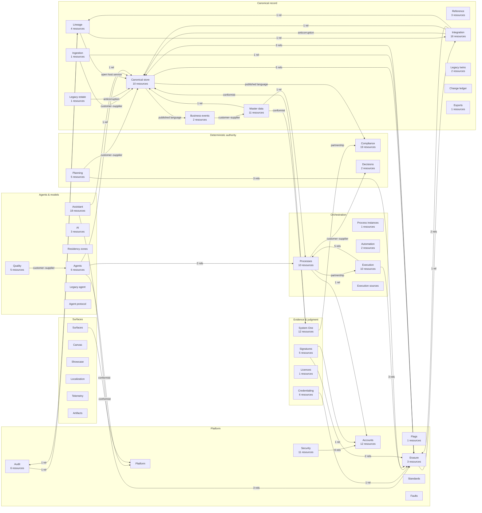

# The domain map

This is the map of the platform's bounded contexts: which capability each owns, what language it
speaks, and how it relates to the others. Regenerate it with `mix ash_enterprise.domain_map`
(`--check` in CI); the editorial content — missions, terms, edges, package roles — lives in
[`domain-map.json`](domain-map.json), edited there and never in the generated regions.

## The unified model

Everything that enters the platform arrives through an integration edge and lands as a canonical,
temporal operational record. Nothing is read out of a side door: the record's own events are the
only thing downstream machinery sees, and every read of it is as of some instant.

Two derivations hang off that record. Its writes yield a business-event ledger, and master data
resolves entities over that ledger's raw landings into golden records the operational store reads.
The record is the spine; the ledger and the golden records are projections of it, never a second
truth.

Determinism and observation meet on top of it. Deterministic declarations — rule sets, decision
tables, constraint models — decide, and every decision they make is recorded with what it was asked
and what it answered. Probabilistic observations — judgments over evidence — are recorded, banded
against thresholds earned by calibration, and only become authority through a person's verdict or a
deciding declaration. Missing evidence is unknown, never a pass.

Processes orchestrate the consequences. A process runs on an immutable compiled graph, is started
by a dispatched cursor over the audit chain rather than an in-process handler, and every service
task it reaches resolves to a declaration or a governed invocation.

Every consequential act — a person's, an agent's, or a process service task's — is one governed
invocation: a lease, effects declared on the action, reconciliation when the outcome is unknown,
and a release that is a gated, attested manifest. Agents are users of the same action layer under
the same grants; there is no parallel path for them, and no second authorization model anywhere.

Finally, every surface renders from the same declarations the platform runs on. An experience
layer encodes agent-renderable payloads from the resources; an admin surface mounts over them; a
canvas inspects them. A surface can add presentation, never authorization.

## The planes

<!-- domain-map:graph:start -->

<!-- domain-map:graph:end -->

<!-- domain-map:contexts:start -->

| Context | Plane | Domain | Mission |
|---|---|---|---|
| [Platform](#platform) | Platform | — | The base resource and its inherited concerns; the cross-substrate battery proving the seams. |
| [Accounts](#accounts) | Platform | `AshEnterprise.Accounts` | Identity: users, teams, from the published schema commons. |
| [Security](#security) | Platform | `AshEnterprise.Security` | Authorization as data: (role, privilege, depth) grants as a pure union; the automation principal and its grants. |
| [Flags](#flags) | Platform | `AshEnterprise.Flags` | Feature flags, tenant by tenant, resolved once per request into the actor's context. |
| [Audit](#audit) | Platform | `AshEnterprise.Audit` | The tamper-evident, tenant-scoped event ledger every projection reads from. |
| [Erasure](#erasure) | Platform | `AshEnterprise.Erasure` | Crypto-shredding and retention: the right to be forgotten over an append-only ledger. |
| [Standards](#standards) | Platform | — | The advisory standards review over this repository's own code; never fails a build. |
| [Faults](#faults) | Platform | — | Named fault points: places in production code where a test can make the process fail. |
| [Reference](#reference) | Canonical record | `AshEnterprise.Reference` | Published-model reference data; do not invent your nouns. |
| [Ingestion](#ingestion) | Canonical record | `AshEnterprise.Ingestion` | External corpora land as Ash resources, not staging schemas. |
| [Integration](#integration) | Canonical record | `AshEnterprise.Integration` | The provider edge: declared operations, webhook ingress, scoped landing under erasure scopes. |
| [Legacy estate](#legacy) | Canonical record | `AshEnterprise.Legacy` | The projected read model over the strangler'd legacy schema. |
| [Legacy twins](#legacy-twins) | Canonical record | `AshEnterprise.Legacy.Twins` | Twin/shadow resources proving projection parity before cutover. |
| [Change ledger](#ledger) | Canonical record | — | The change ledger a legacy trigger writes; the drain turns a row into a canonical action in one transaction. |
| [Canonical store](#canonical) | Canonical record | `AshEnterprise.Canonical` | The CDM-derived operational store on the temporal validity substrate. |
| [Business events](#business-events) | Canonical record | `AshEnterprise.BusinessEvents` | The chained, commit-ordered discrete event ledger derived from canonical writes. |
| [Master data](#mdm) | Canonical record | `AshEnterprise.Mdm` | Versioned mappings, deterministic entity resolution, survivorship, non-destructive merges over golden records. |
| [Lineage](#lineage) | Canonical record | `AshEnterprise.Lineage` | Run-event lineage emitted from action notifications. |
| [Exports](#exports) | Canonical record | `AshEnterprise.Exports` | Bulk export out: a tenant's data as CSV, under the same policies as every other read. |
| [System One](#system-one) | Evidence & judgment | `AshEnterprise.SystemOne` | Declared questions, the append-only judgment ledger, banding, admitted facts, human verdicts; evidence adjudication as assertions. |
| [Credentialing](#credentialing) | Evidence & judgment | `AshEnterprise.Credentialing` | The credentialing vertical slice composing evidence, judgment and process end to end. |
| [Licences](#licences) | Evidence & judgment | `AshEnterprise.Licences` | Dependency licence adjudication; judgments declared on dependency resources. |
| [Signatures](#signatures) | Evidence & judgment | `AshEnterprise.Signatures` | Signature and acknowledgement requests: the five fragments on the platform base. |
| [Compliance](#compliance) | Deterministic authority | `AshEnterprise.Compliance` | Findings projected from the event log under immutable, content-hashed rule bundles; missing evidence is unknown, never compliant. |
| [Decisions](#decisions) | Deterministic authority | `AshEnterprise.Decisions` | DMN decisions as versioned resources over a native expression engine; band tables live here. |
| [Planning](#planning) | Deterministic authority | `AshEnterprise.Planning` | Constraint models propose; declarations and people commit. |
| [Processes](#bpmn) | Orchestration | `AshEnterprise.Bpmn` | BPMN documents compiled to immutable graphs, executed by a token interpreter. |
| [Process instances](#process) | Orchestration | `AshEnterprise.Process` | Host process instances and the dispatched-cursor event triggers. |
| [Automation](#automation) | Orchestration | `AshEnterprise.Automation` | What a tenant's recipes react to when the thing that happened is not an audited tenant write. |
| [Execution](#execution) | Orchestration | `AshEnterprise.Execution` | Identity resolution and the governed-invocation lease/job handoff every consequential act runs through. |
| [Execution sources](#execution-sources) | Orchestration | — | Provenance sources for executions. |
| [Agents](#agents) | Agents & models | `AshEnterprise.Agents` | Governed invocations, durable runs, the coding-agent bridge; effects declared per action. |
| [AI](#ai) | Agents & models | `AshEnterprise.AI` | Model wiring and residency: in-zone inference; leaving the zone is a disclosure. |
| [Residency zones](#zones) | Agents & models | — | The residency policy deciding which zones instruments may run in; configuration, never code. |
| [Assistant](#assistant) | Agents & models | `AshEnterprise.Assistant` | The host assistant and its evaluation harness. |
| [Legacy agent](#legacy-agent) | Agents & models | `AshEnterprise.LegacyAgent` | The agent console over the legacy estate. |
| [Quality](#quality) | Agents & models | `AshEnterprise.Quality` | Agent-quality suites and gated, attested releases. |
| [Agent protocol](#acp) | Agents & models | — | The agent-client wire adapter: sessions and permission requests over host behaviours. |
| [Surfaces](#surfaces) | Surfaces | — | The agent-renderable experience layer bound to host resources. |
| [Canvas](#canvas) | Surfaces | — | The dev-only object graph inspector. |
| [Showcase](#showcase) | Surfaces | — | The guided demonstration estate. |
| [Localization](#l10n) | Surfaces | — | Gettext catalogs and library-shipped translations. |
| [Telemetry](#telemetry) | Surfaces | — | Tracer → OpenTelemetry → OTLP wiring. |
| [Artifacts](#artifacts) | Surfaces | — | The artifact registry: every versioned thing a person authors, reviews or releases, declared once. |

<!-- domain-map:contexts:end -->

## Bounded contexts

### Platform

<!-- domain-map:context:platform:start -->

Plane: **Platform** · Packages: `battery` · ADRs: [ADR 4](adr/0004-reactor-over-oban-pro.md), [ADR 52](adr/0052-self-service-actions.md), [ADR 59](adr/0059-version-number-is-an-optimistic-lock.md)

The base resource and its inherited concerns; the cross-substrate battery proving the seams.

**Ubiquitous language**

| Term | Meaning |
|---|---|
| **base resource** | Every resource uses AshEnterprise.Platform.Resource; opting out is explicit and greppable, never silent. |
| **ActorContext** | Everything a policy check needs is precomputed once per request into ActorContext; a check that queries is a bug, not a slow path. |
| **battery** | The cross-substrate integration battery, run over its own reference instantiation on dependency bumps. |

<!-- domain-map:context:platform:end -->

### Accounts

<!-- domain-map:context:accounts:start -->

Plane: **Platform** · Domain: `AshEnterprise.Accounts` · ADRs: [ADR 2](adr/0002-ash-events-over-paper-trail.md), [ADR 3](adr/0003-attribute-multitenancy.md)

Identity: users, teams, from the published schema commons.

**Ubiquitous language**

| Term | Meaning |
|---|---|
| **user** | A person who can sign in, and the actor every policy is evaluated against. |
| **organization** | A tenant. |
| **business unit** | A node in the organizational hierarchy, and the unit of the Local and Deep access levels. |
| **team** | A group of users; by type either a principal that can own records and hold roles, or a lightweight bucket for sharing. |

**Resources** — 12 introspected

| Resource | Description | Aggregates | Calculations |
|---|---|---|---|
| `AshEnterprise.Accounts.ApiKey` | — | 0 | 0 |
| `AshEnterprise.Accounts.BusinessUnit` | — | 1 | 5 |
| `AshEnterprise.Accounts.Offboarding` | — | 0 | 0 |
| `AshEnterprise.Accounts.Organization` | — | 0 | 2 |
| `AshEnterprise.Accounts.Position` | — | 0 | 2 |
| `AshEnterprise.Accounts.ProjectedUser` | — | 0 | 5 |
| `AshEnterprise.Accounts.SignInLockout` | — | 0 | 0 |
| `AshEnterprise.Accounts.Team` | — | 0 | 4 |
| `AshEnterprise.Accounts.TeamMembership` | — | 0 | 0 |
| `AshEnterprise.Accounts.Token` | — | 0 | 0 |
| `AshEnterprise.Accounts.User` | — | 0 | 2 |
| `AshEnterprise.Accounts.UserIdentity` | — | 0 | 0 |

<!-- domain-map:context:accounts:end -->

### Security

<!-- domain-map:context:security:start -->

Plane: **Platform** · Domain: `AshEnterprise.Security` · ADRs: [ADR 3](adr/0003-attribute-multitenancy.md), [ADR 23](adr/0023-impersonation-is-attribution.md), [ADR 43](adr/0043-automation-authority-is-a-grant.md), [ADR 52](adr/0052-self-service-actions.md)

Authorization as data: (role, privilege, depth) grants as a pure union; the automation principal and its grants.

**Ubiquitous language**

| Term | Meaning |
|---|---|
| **role** | A named bag of (privilege, depth) grants. |
| **privilege** | One (resource, verb) pair that a role can grant. |
| **role privilege** | The (role, privilege, depth) triple; depth scopes it to global, business unit or record. |
| **access grant** | An explicit share: (principal, record, rights). |
| **automation role** | Assigns a role to an automation principal, scoped to a business unit (ADR 0043). |

**Resources** — 11 introspected

| Resource | Description | Aggregates | Calculations |
|---|---|---|---|
| `AshEnterprise.Security.AccessGrant` | — | 0 | 1 |
| `AshEnterprise.Security.AccessRequest` | — | 0 | 2 |
| `AshEnterprise.Security.AgentStartGrant` | — | 0 | 0 |
| `AshEnterprise.Security.AuthenticationEvent` | — | 0 | 0 |
| `AshEnterprise.Security.AutomationRole` | — | 0 | 0 |
| `AshEnterprise.Security.BreakGlassSession` | — | 0 | 2 |
| `AshEnterprise.Security.Privilege` | — | 0 | 0 |
| `AshEnterprise.Security.Role` | — | 0 | 2 |
| `AshEnterprise.Security.RolePrivilege` | — | 0 | 0 |
| `AshEnterprise.Security.TeamRole` | — | 0 | 0 |
| `AshEnterprise.Security.UserRole` | — | 0 | 0 |

<!-- domain-map:context:security:end -->

### Flags

<!-- domain-map:context:flags:start -->

Plane: **Platform** · Domain: `AshEnterprise.Flags` · ADRs: [ADR 72](adr/0072-ash-native-tenant-flags.md)

Feature flags, tenant by tenant, resolved once per request into the actor's context.

**Ubiquitous language**

| Term | Meaning |
|---|---|
| **catalogue** | The keys this build declares, and the ones the deployment killed. |
| **flag** | One tenant's decision for one key: off, on, or on for named people, teams, business-unit subtrees and a percentage. |
| **targeting** | Whether a row is on for a person, pure. |

**Resources** — 1 introspected

| Resource | Description | Aggregates | Calculations |
|---|---|---|---|
| `AshEnterprise.Flags.Flag` | — | 0 | 0 |

<!-- domain-map:context:flags:end -->

### Audit

<!-- domain-map:context:audit:start -->

Plane: **Platform** · Domain: `AshEnterprise.Audit` · Packages: `ash_events`, `ash_events_projections`, `ash_events_chain` · ADRs: [ADR 2](adr/0002-ash-events-over-paper-trail.md), [ADR 20](adr/0020-tamper-evident-audit-log.md), [ADR 22](adr/0022-audit-log-is-tenant-scoped.md), [ADR 24](adr/0024-audit-retention-and-erasure.md)

The tamper-evident, tenant-scoped event ledger every projection reads from.

**Ubiquitous language**

| Term | Meaning |
|---|---|
| **event log** | The central audit trail. |
| **hash chain** | Each chain's rows link by hash; the verifier walks every chain and reports where, if anywhere, it stops adding up. |
| **projection** | A read model built from the event log; how far each projector has processed is its checkpoint. |

**Resources** — 6 introspected

| Resource | Description | Aggregates | Calculations |
|---|---|---|---|
| `AshEnterprise.Audit.ArchiveRun` | — | 0 | 0 |
| `AshEnterprise.Audit.ArchivedEvent` | — | 0 | 0 |
| `AshEnterprise.Audit.ArchivedEvidence` | — | 0 | 0 |
| `AshEnterprise.Audit.EventLog` | — | 0 | 0 |
| `AshEnterprise.Audit.ExportCursor` | — | 0 | 0 |
| `AshEnterprise.Audit.Package` | — | 0 | 0 |

<!-- domain-map:context:audit:end -->

### Erasure

<!-- domain-map:context:erasure:start -->

Plane: **Platform** · Domain: `AshEnterprise.Erasure` · Packages: `ash_greenmask` · ADRs: [ADR 24](adr/0024-audit-retention-and-erasure.md), [ADR 32](adr/0032-anonymization-config-is-generated.md)

Crypto-shredding and retention: the right to be forgotten over an append-only ledger.

**Ubiquitous language**

| Term | Meaning |
|---|---|
| **erasure scope** | The unit that one key encrypts and one shred destroys. |
| **key** | One erasure scope's data-encryption key, stored wrapped under the master key. |
| **crypto-shredding** | Destroying a scope's key renders everything the scope covered unreadable, without rewriting a single appended row. |

**Resources** — 3 introspected

| Resource | Description | Aggregates | Calculations |
|---|---|---|---|
| `AshEnterprise.Erasure.Key` | — | 0 | 0 |
| `AshEnterprise.Erasure.PersonErasure` | — | 0 | 0 |
| `AshEnterprise.Erasure.Scope` | — | 3 | 4 |

<!-- domain-map:context:erasure:end -->

### Standards

<!-- domain-map:context:standards:start -->

Plane: **Platform** · Packages: `ash_agent_tools` · ADRs: [ADR 45](adr/0045-system-one-in-tooling-is-advisory.md)

The advisory standards review over this repository's own code; never fails a build.

**Ubiquitous language**

| Term | Meaning |
|---|---|
| **standards review** | The cheapest place to use a fast typed judgment is not the product; it is the tooling around it — the review judges this repository's own code. |
| **advisory** | A finding here never fails a build; it is reported for a person to weigh. |
| **standing check** | The standing review records the last checkout HEAD it judged in full, per tenant and repository. |

<!-- domain-map:context:standards:end -->

### Faults

<!-- domain-map:context:faults:start -->

Plane: **Platform**

Named fault points: places in production code where a test can make the process fail.

**Ubiquitous language**

| Term | Meaning |
|---|---|
| **fault point** | A named place in production code where a test can make the process fail, because the code that commits is the code that must stop. |
| **arm** | A test arms a fault point by name before the code under test runs. |
| **kill** | The fault that kills the calling process outright, uncatchable — the nearest thing to the node dying that a test can do without stopping the node. |

<!-- domain-map:context:faults:end -->

### Reference

<!-- domain-map:context:reference:start -->

Plane: **Canonical record** · Domain: `AshEnterprise.Reference` · ADRs: [ADR 2](adr/0002-ash-events-over-paper-trail.md)

Published-model reference data; do not invent your nouns.

**Ubiquitous language**

| Term | Meaning |
|---|---|
| **reference data** | Published-model reference data, generated from the vendored corpus rather than invented. |
| **generated resource** | Generated by mix cdm.gen.resource from a resolved corpus document. |
| **CDM** | The frozen, hybrid, vendored corpus the reference data is generated from. |

**Resources** — 3 introspected

| Resource | Description | Aggregates | Calculations |
|---|---|---|---|
| `AshEnterprise.Reference.Currency` | — | 0 | 2 |
| `AshEnterprise.Reference.LanguageLocale` | — | 0 | 2 |
| `AshEnterprise.Reference.TimeZoneDefinition` | — | 0 | 2 |

<!-- domain-map:context:reference:end -->

### Ingestion

<!-- domain-map:context:ingestion:start -->

Plane: **Canonical record** · Domain: `AshEnterprise.Ingestion` · ADRs: [ADR 10](adr/0010-meltano-for-ingestion.md)

External corpora land as Ash resources, not staging schemas.

**Ubiquitous language**

| Term | Meaning |
|---|---|
| **source object** | The immutable raw-landing record for one external object. |
| **landing** | External corpora land into an Ash resource, not a staging schema. |
| **tap** | The deterministic fixture tap lands records as source objects. |

**Resources** — 1 introspected

| Resource | Description | Aggregates | Calculations |
|---|---|---|---|
| `AshEnterprise.Ingestion.SourceObject` | — | 0 | 1 |

<!-- domain-map:context:ingestion:end -->

### Integration

<!-- domain-map:context:integration:start -->

Plane: **Canonical record** · Domain: `AshEnterprise.Integration` · Packages: `ash_operations` · ADRs: [ADR 11](adr/0011-nango-as-integration-hub.md), [ADR 63](adr/0063-declared-operations-are-a-package.md)

The provider edge: declared operations, webhook ingress, scoped landing under erasure scopes.

**Ubiquitous language**

| Term | Meaning |
|---|---|
| **linked account** | One of an actor's own provider accounts, mapped to the connection that holds its credentials; the unit of credential ownership is the user account. |
| **declared operation** | One generic action and one code interface per provider operation, with a vendored spec pinned by sha-256 and one transport per provider. |
| **delivery** | A provider webhook delivery, recorded once. |

**Resources** — 16 introspected

| Resource | Description | Aggregates | Calculations |
|---|---|---|---|
| `AshEnterprise.Integration.Calendar.Sync` | — | 0 | 0 |
| `AshEnterprise.Integration.Calendar.SyncCursor` | — | 0 | 0 |
| `AshEnterprise.Integration.LinkedAccount` | — | 7 | 8 |
| `AshEnterprise.Integration.Operations.Delivery` | — | 0 | 0 |
| `AshEnterprise.Integration.Outbound.Delivery` | — | 0 | 0 |
| `AshEnterprise.Integration.Outbound.Endpoint` | — | 0 | 0 |
| `AshEnterprise.Integration.Outbound.Receiver` | — | 0 | 0 |
| `AshEnterprise.Integration.ProjectionCursor` | — | 0 | 0 |

*8 provider-named resources omitted from this table.*

<!-- domain-map:context:integration:end -->

### Legacy estate

<!-- domain-map:context:legacy:start -->

Plane: **Canonical record** · Domain: `AshEnterprise.Legacy` · Packages: `ash_strangler` · ADRs: [ADR 8](adr/0008-typed-invertible-legacy-mappings.md), [ADR 9](adr/0009-strangler-and-bpmn-are-first-party.md), [ADR 31](adr/0031-the-legacy-estate-is-projected-not-cut-over.md)

The projected read model over the strangler'd legacy schema.

**Ubiquitous language**

| Term | Meaning |
|---|---|
| **read model** | A platform resource whose data layer is a compatibility view over a legacy table rather than a table this application owns. |
| **mapping** | A typed expression over a legacy relation's columns, with a proven inverse. |
| **legacy user** | The read model over the legacy users table. |

**Resources** — 1 introspected

| Resource | Description | Aggregates | Calculations |
|---|---|---|---|
| `AshEnterprise.Legacy.User` | — | 0 | 2 |

<!-- domain-map:context:legacy:end -->

### Legacy twins

<!-- domain-map:context:legacy-twins:start -->

Plane: **Canonical record** · Domain: `AshEnterprise.Legacy.Twins` · Packages: `ash_strangler` · ADRs: [ADR 31](adr/0031-the-legacy-estate-is-projected-not-cut-over.md)

Twin/shadow resources proving projection parity before cutover.

**Ubiquitous language**

| Term | Meaning |
|---|---|
| **twin** | The legacy relation declared as an ordinary Ash resource, so a mapping can name its columns and have them mean something. |
| **parity** | The twin and its projection must agree before anything cuts over; the twin makes the disagreement visible. |
| **cutover** | The legacy estate is projected, not cut over. |

**Resources** — 2 introspected

| Resource | Description | Aggregates | Calculations |
|---|---|---|---|
| `AshEnterprise.Legacy.Twins.Companies` | — | 0 | 0 |
| `AshEnterprise.Legacy.Twins.Users` | — | 0 | 0 |

<!-- domain-map:context:legacy-twins:end -->

### Change ledger

<!-- domain-map:context:ledger:start -->

Plane: **Canonical record** · Packages: `ash_strangler` · ADRs: [ADR 30](adr/0030-events-trigger-processes.md), [ADR 35](adr/0035-compliance-is-projected-from-events.md)

The change ledger a legacy trigger writes; the drain turns a row into a canonical action in one transaction.

**Ubiquitous language**

| Term | Meaning |
|---|---|
| **ledger row** | The row a legacy trigger writes recording that a legacy write happened. |
| **drain** | An at-least-once worker that projects a ledger row into a canonical action in one transaction. |
| **legacy write** | A write in the old schema; the chain legacy write → ledger row → drain → canonical action is the strangler demo in one line. |

<!-- domain-map:context:ledger:end -->

### Canonical store

<!-- domain-map:context:canonical:start -->

Plane: **Canonical record** · Domain: `AshEnterprise.Canonical` · ADRs: [ADR 1](adr/0001-cdm-as-frozen-hybrid-corpus.md), [ADR 2](adr/0002-ash-events-over-paper-trail.md), [ADR 49](adr/0049-temporal-resources-are-the-validity-substrate.md)

The CDM-derived operational store on the temporal validity substrate.

**Ubiquitous language**

| Term | Meaning |
|---|---|
| **person** | A person in the operator's world: the organizer of a meeting, a message correspondent, a task's assignee. |
| **conversation** | A thread: an email thread, a chat channel or DM, or a face-to-face the operator logged. |
| **message** | One sent or received item in a conversation, with its sender, timestamp and direction. |
| **task** | A commitment with a status. |
| **calendar event** | One calendar event, projected from landed source objects. |

**Resources** — 10 introspected

| Resource | Description | Aggregates | Calculations |
|---|---|---|---|
| `AshEnterprise.Canonical.Account` | — | 0 | 0 |
| `AshEnterprise.Canonical.CalendarEvent` | — | 1 | 5 |
| `AshEnterprise.Canonical.CommitmentScan` | — | 0 | 0 |
| `AshEnterprise.Canonical.Conversation` | — | 2 | 5 |
| `AshEnterprise.Canonical.ConversationParticipant` | — | 0 | 0 |
| `AshEnterprise.Canonical.EventAttendee` | — | 0 | 1 |
| `AshEnterprise.Canonical.Message` | — | 0 | 4 |
| `AshEnterprise.Canonical.Person` | — | 3 | 4 |
| `AshEnterprise.Canonical.Project` | — | 0 | 0 |
| `AshEnterprise.Canonical.Task` | — | 0 | 10 |

<!-- domain-map:context:canonical:end -->

### Business events

<!-- domain-map:context:business-events:start -->

Plane: **Canonical record** · Domain: `AshEnterprise.BusinessEvents` · Packages: `ash_discrete_business_events` · ADRs: [ADR 51](adr/0051-business-events-are-derived-from-the-canonical-store.md), [ADR 30](adr/0030-events-trigger-processes.md)

The chained, commit-ordered discrete event ledger derived from canonical writes.

**Ubiquitous language**

| Term | Meaning |
|---|---|
| **ledger** | The business-event ledger, a :ledger macro instantiated on the platform base so the tables are this application's. |
| **region** | A partition of the ledger's chain, lock and feed; every row declares its residency tag. |
| **residency tag** | What every row declares. |

**Resources** — 2 introspected

| Resource | Description | Aggregates | Calculations |
|---|---|---|---|
| `AshEnterprise.BusinessEvents.Ledger` | — | 0 | 0 |
| `AshEnterprise.BusinessEvents.Ledger.SimulationEvent` | — | 0 | 0 |

<!-- domain-map:context:business-events:end -->

### Master data

<!-- domain-map:context:mdm:start -->

Plane: **Canonical record** · Domain: `AshEnterprise.Mdm` · Packages: `ash_mdm` · ADRs: [ADR 17](adr/0017-entity-resolution-in-ash.md), [ADR 54](adr/0054-mdm-stewardship-is-system-one.md)

Versioned mappings, deterministic entity resolution, survivorship, non-destructive merges over golden records.

**Ubiquitous language**

| Term | Meaning |
|---|---|
| **mapping** | A versioned schema mapping, ingress or egress. |
| **staged record** | One landed source row, mapped into canonical shape by the batch's pinned mapping. |
| **match candidate** | One (staged record, golden record) candidate pair with its score and per-rule explanation. |
| **source identity** | The cross-reference registry: which external source identity points at which golden record, right now — temporal, one open period per identity. |
| **golden record** | The survived, merged record the operational store reads; merges are non-destructive. |

**Resources** — 11 introspected

| Resource | Description | Aggregates | Calculations |
|---|---|---|---|
| `AshEnterprise.Mdm.AttributeAssertion` | — | 0 | 0 |
| `AshEnterprise.Mdm.Egress` | — | 0 | 0 |
| `AshEnterprise.Mdm.ImportBatch` | — | 0 | 2 |
| `AshEnterprise.Mdm.ImportRowRefusal` | — | 0 | 0 |
| `AshEnterprise.Mdm.Mapping` | — | 0 | 2 |
| `AshEnterprise.Mdm.MappingProposal` | — | 0 | 0 |
| `AshEnterprise.Mdm.MatchCandidate` | — | 0 | 12 |
| `AshEnterprise.Mdm.MatchRuleSet` | — | 0 | 0 |
| `AshEnterprise.Mdm.SourceIdentity` | — | 0 | 0 |
| `AshEnterprise.Mdm.SourceRecord` | — | 0 | 0 |
| `AshEnterprise.Mdm.StagedRecord` | — | 0 | 3 |

<!-- domain-map:context:mdm:end -->

### Lineage

<!-- domain-map:context:lineage:start -->

Plane: **Canonical record** · Domain: `AshEnterprise.Lineage` · Packages: `ash_open_lineage` · ADRs: [ADR 12](adr/0012-openlineage-and-marquez.md)

Run-event lineage emitted from action notifications.

**Ubiquitous language**

| Term | Meaning |
|---|---|
| **run** | One operation: every lineage event that shared a correlation id. |
| **job** | One lineage job, per tenant, named structurally. |
| **job run** | One lineage run: one job inside one operation, keyed by the event's run id. |

**Resources** — 4 introspected

| Resource | Description | Aggregates | Calculations |
|---|---|---|---|
| `AshEnterprise.Lineage.Job` | — | 0 | 0 |
| `AshEnterprise.Lineage.JobRun` | — | 0 | 3 |
| `AshEnterprise.Lineage.Run` | — | 5 | 2 |
| `AshEnterprise.Lineage.Window` | — | 0 | 0 |

<!-- domain-map:context:lineage:end -->

### Exports

<!-- domain-map:context:exports:start -->

Plane: **Canonical record** · Domain: `AshEnterprise.Exports` · ADRs: [ADR 59](adr/0059-version-number-is-an-optimistic-lock.md)

Bulk export out: a tenant's data as CSV, under the same policies as every other read.

**Ubiquitous language**

| Term | Meaning |
|---|---|
| **export** | The export privilege: one more grantable (resource, verb) row, held by default by the tenant's Administrator role and nobody else. |
| **exportable** | Which resources are exportable. |
| **csv stream** | The stream of one exportable resource, read in keyset pages as the requester. |

**Resources** — 1 introspected

| Resource | Description | Aggregates | Calculations |
|---|---|---|---|
| `AshEnterprise.Exports.Export` | — | 0 | 0 |

<!-- domain-map:context:exports:end -->

### System One

<!-- domain-map:context:system-one:start -->

Plane: **Evidence & judgment** · Domain: `AshEnterprise.SystemOne` · Packages: `ash_judgments`, `ash_evidence` · ADRs: [ADR 38](adr/0038-models-observe-declarations-decide.md), [ADR 39](adr/0039-judgments-are-declared-questions.md), [ADR 40](adr/0040-record-dont-recompute.md), [ADR 41](adr/0041-thresholds-are-dmn-earned-by-calibration.md), [ADR 42](adr/0042-in-zone-inference-leaving-the-zone-is-a-disclosure.md), [ADR 43](adr/0043-automation-authority-is-a-grant.md), [ADR 44](adr/0044-documents-are-addressed-atoms-evidence-is-an-assertion.md), [ADR 45](adr/0045-system-one-in-tooling-is-advisory.md), [ADR 46](adr/0046-the-declaration-is-the-output-contract.md), [ADR 47](adr/0047-learning-produces-proposals.md), [ADR 48](adr/0048-a-judgment-is-a-predicate-over-any-set.md), [ADR 53](adr/0053-subject-state-digest-third-axis.md)

Declared questions, the append-only judgment ledger, banding, admitted facts, human verdicts; evidence adjudication as assertions.

**Ubiquitous language**

| Term | Meaning |
|---|---|
| **judgment** | One append-only observation per question per call, in the judgment ledger. |
| **human verdict** | A person's confirmation or correction of a recorded observation. |
| **banding** | Which band-table row a judged answer fell into. |
| **calibration run** | One calibration record per (family, question hashes, model digest, runtime version, eval-set hash, region), whose metrics earn a band-table proposal. |
| **fact** | The materialised-facts table: what the set evaluator, the filters and the standing queries read. |
| **evidence assertion** | The aggregate evidence verdict one packet's adjudication produced — the admission's provenance. |

**Resources** — 12 introspected

| Resource | Description | Aggregates | Calculations |
|---|---|---|---|
| `AshEnterprise.SystemOne.BandTableCertification` | — | 0 | 0 |
| `AshEnterprise.SystemOne.Banding` | — | 0 | 8 |
| `AshEnterprise.SystemOne.CalibrationRun` | — | 0 | 3 |
| `AshEnterprise.SystemOne.CalibrationSample` | — | 0 | 0 |
| `AshEnterprise.SystemOne.EvidenceAssertion` | — | 0 | 0 |
| `AshEnterprise.SystemOne.Fact` | — | 0 | 3 |
| `AshEnterprise.SystemOne.FilterExecution` | — | 0 | 0 |
| `AshEnterprise.SystemOne.FilterProposal` | — | 0 | 0 |
| `AshEnterprise.SystemOne.HumanVerdict` | — | 0 | 0 |
| `AshEnterprise.SystemOne.Judgment` | — | 0 | 0 |
| `AshEnterprise.SystemOne.QuestionProposal` | — | 0 | 2 |
| `AshEnterprise.SystemOne.StandingHead` | — | 0 | 0 |

<!-- domain-map:context:system-one:end -->

### Credentialing

<!-- domain-map:context:credentialing:start -->

Plane: **Evidence & judgment** · Domain: `AshEnterprise.Credentialing`

The credentialing vertical slice composing evidence, judgment and process end to end.

**Ubiquitous language**

| Term | Meaning |
|---|---|
| **clinic** | The organization a clinician works for. |
| **clinician** | A clinician a clinic is onboarding. |
| **credential** | A clinician's licence or certification, recorded at the clinic and activated with the registry before the clinician may practise there. |

**Resources** — 6 introspected

| Resource | Description | Aggregates | Calculations |
|---|---|---|---|
| `AshEnterprise.Credentialing.Clinic` | — | 0 | 2 |
| `AshEnterprise.Credentialing.Clinician` | — | 0 | 2 |
| `AshEnterprise.Credentialing.Credential` | — | 0 | 1 |
| `AshEnterprise.Credentialing.DocumentEvent` | — | 0 | 0 |
| `AshEnterprise.Credentialing.LicenceDocument` | — | 0 | 0 |
| `AshEnterprise.Credentialing.RegistryApi` | — | 0 | 0 |

<!-- domain-map:context:credentialing:end -->

### Licences

<!-- domain-map:context:licences:start -->

Plane: **Evidence & judgment** · Domain: `AshEnterprise.Licences`

Dependency licence adjudication; judgments declared on dependency resources.

**Ubiquitous language**

| Term | Meaning |
|---|---|
| **dependency** | A third-party package at the version the lockfile resolves: the subject of the licence policy. |
| **licence policy** | The declared policy the dependency's questions are answered against. |
| **rung** | Which rung answers a licence subject; a release reaches the model only when its declaration cannot settle the questions. |
| **declaration rung** | The release declares exactly one licence id the policy classifies; every question is answered from the id. |

**Resources** — 1 introspected

| Resource | Description | Aggregates | Calculations |
|---|---|---|---|
| `AshEnterprise.Licences.Dependency` | — | 0 | 0 |

<!-- domain-map:context:licences:end -->

### Signatures

<!-- domain-map:context:signatures:start -->

Plane: **Evidence & judgment** · Domain: `AshEnterprise.Signatures` · Packages: `ash_signatures` · ADRs: [ADR 74](adr/0074-signatures-are-a-package.md), [ADR 32](adr/0032-anonymization-config-is-generated.md)

Signature and acknowledgement requests: the five fragments on the platform base.

**Ubiquitous language**

| Term | Meaning |
|---|---|
| **request** | People asked to sign or acknowledge exact document versions, in order. |
| **request document** | One document version a request shows, with its SHA-256 copied from it. |
| **signer** | One person asked, acting on their own row. |
| **signer event** | One thing that happened, append-only. |

**Resources** — 5 introspected

| Resource | Description | Aggregates | Calculations |
|---|---|---|---|
| `AshEnterprise.Signatures.Completion` | — | 0 | 0 |
| `AshEnterprise.Signatures.Request` | — | 0 | 0 |
| `AshEnterprise.Signatures.RequestDocument` | — | 0 | 0 |
| `AshEnterprise.Signatures.Signer` | — | 0 | 7 |
| `AshEnterprise.Signatures.SignerEvent` | — | 0 | 5 |

<!-- domain-map:context:signatures:end -->

### Compliance

<!-- domain-map:context:compliance:start -->

Plane: **Deterministic authority** · Domain: `AshEnterprise.Compliance` · Packages: `ash_rules`, `ash_compliance` · ADRs: [ADR 21](adr/0021-control-mapping-is-generated.md), [ADR 35](adr/0035-compliance-is-projected-from-events.md)

Findings projected from the event log under immutable, content-hashed rule bundles; missing evidence is unknown, never compliant.

**Ubiquitous language**

| Term | Meaning |
|---|---|
| **catalog** | A compliance catalog: the stable identity a stream of immutable revisions hangs off. |
| **policy bundle** | The immutable, content-hashed compiled artifact: the effective rule bundle for an organization at a point in time. |
| **finding** | The current compliance state of one subject against one control. |
| **policy override** | An approval-bearing exception: a replacement of a rule, or a waiver of one, with the accountability the framework requires. |
| **evaluation** | The append-only record of one evaluation: what the engine decided and why. |

**Resources** — 19 introspected

| Resource | Description | Aggregates | Calculations |
|---|---|---|---|
| `AshCompliance.Resources.Catalog` | — | 0 | 0 |
| `AshCompliance.Resources.CatalogVersion` | — | 0 | 1 |
| `AshCompliance.Resources.ComplianceEvaluation` | — | 0 | 0 |
| `AshCompliance.Resources.Control` | — | 0 | 0 |
| `AshCompliance.Resources.ControlMapping` | — | 0 | 0 |
| `AshCompliance.Resources.ControlRevision` | — | 0 | 1 |
| `AshCompliance.Resources.EvidenceArtifact` | — | 0 | 0 |
| `AshCompliance.Resources.Finding` | — | 0 | 0 |
| `AshCompliance.Resources.PolicyBundle` | — | 0 | 1 |
| `AshCompliance.Resources.PolicyOverride` | — | 0 | 2 |
| `AshCompliance.Resources.Profile` | — | 0 | 0 |
| `AshCompliance.Resources.ProfileRevision` | — | 0 | 1 |
| `AshCompliance.Resources.RuleSetRevision` | — | 0 | 0 |
| `AshCompliance.Resources.TenantPolicySet` | — | 0 | 0 |
| `AshEnterprise.Compliance.EventLog` | — | 0 | 0 |
| `AshEnterprise.Compliance.Policy` | — | 0 | 0 |
| `AshEvents.Projections.Checkpoint` | — | 0 | 0 |
| `AshEvents.Projections.DeadLetter` | — | 0 | 0 |
| `AshEvents.Projections.Registry` | — | 0 | 0 |

<!-- domain-map:context:compliance:end -->

### Decisions

<!-- domain-map:context:decisions:start -->

Plane: **Deterministic authority** · Domain: `AshEnterprise.Decisions` · Packages: `ash_decisions`, `boxic_dmn`, `boxic_feel` · ADRs: [ADR 27](adr/0027-feel-is-the-expression-language.md), [ADR 28](adr/0028-decisions-are-dmn.md), [ADR 41](adr/0041-thresholds-are-dmn-earned-by-calibration.md)

DMN decisions as versioned resources over a native expression engine; band tables live here.

**Ubiquitous language**

| Term | Meaning |
|---|---|
| **definition** | A published decision document, compiled into an immutable versioned snapshot. |
| **evaluation** | What a decision was asked, and what it answered. |
| **band table** | The versioned threshold table a judged answer is banded against, earned by a certified calibration run. |

**Resources** — 2 introspected

| Resource | Description | Aggregates | Calculations |
|---|---|---|---|
| `AshEnterprise.Decisions.Definition` | — | 0 | 0 |
| `AshEnterprise.Decisions.Evaluation` | — | 0 | 0 |

<!-- domain-map:context:decisions:end -->

### Planning

<!-- domain-map:context:planning:start -->

Plane: **Deterministic authority** · Domain: `AshEnterprise.Planning` · Packages: `ash_planning`, `solverl` · ADRs: [ADR 62](adr/0062-planning-proposes-declarations-and-people-commit.md)

Constraint models propose; declarations and people commit.

**Ubiquitous language**

| Term | Meaning |
|---|---|
| **model version** | One immutable planning model version. |
| **binding** | A tenant's binding of (model key, purpose) to the definitions a plan is made with. |
| **run** | One planning run. |
| **candidate** | One candidate plan a run proposed. |
| **check result** | One check of one candidate. |

**Resources** — 5 introspected

| Resource | Description | Aggregates | Calculations |
|---|---|---|---|
| `AshEnterprise.Planning.Binding` | — | 0 | 0 |
| `AshEnterprise.Planning.Candidate` | — | 0 | 1 |
| `AshEnterprise.Planning.CheckResult` | — | 0 | 1 |
| `AshEnterprise.Planning.ModelVersion` | — | 0 | 0 |
| `AshEnterprise.Planning.Run` | — | 0 | 2 |

<!-- domain-map:context:planning:end -->

### Processes

<!-- domain-map:context:bpmn:start -->

Plane: **Orchestration** · Domain: `AshEnterprise.Bpmn` · Packages: `ash_bpmn` · ADRs: [ADR 9](adr/0009-strangler-and-bpmn-are-first-party.md), [ADR 29](adr/0029-process-configuration-is-tenant-data.md), [ADR 36](adr/0036-converge-process-triggers-onto-projection-checkpoints.md)

BPMN documents compiled to immutable graphs, executed by a token interpreter.

**Ubiquitous language**

| Term | Meaning |
|---|---|
| **definition** | A published process document, compiled into an immutable versioned graph. |
| **instance** | One run of a process, pinned to the definition version it started on. |
| **token** | One live branch of a running process. |
| **human task** | A work item waiting on a person: an approval, a review, a decision someone has to make. |
| **subscription** | A declaration that something happening in the audit log should start a process. |
| **cursor** | How far the trigger sweep has read into one tenant's audit chain. |

**Resources** — 10 introspected

| Resource | Description | Aggregates | Calculations |
|---|---|---|---|
| `AshEnterprise.Bpmn.Cursor` | — | 0 | 1 |
| `AshEnterprise.Bpmn.Definition` | — | 0 | 0 |
| `AshEnterprise.Bpmn.Dispatch` | — | 0 | 0 |
| `AshEnterprise.Bpmn.HumanTask` | — | 0 | 21 |
| `AshEnterprise.Bpmn.Instance` | — | 0 | 4 |
| `AshEnterprise.Bpmn.ProcessEvent` | — | 0 | 0 |
| `AshEnterprise.Bpmn.Redrive` | — | 0 | 0 |
| `AshEnterprise.Bpmn.Subscription` | — | 0 | 0 |
| `AshEnterprise.Bpmn.TaskCandidate` | — | 0 | 0 |
| `AshEnterprise.Bpmn.Token` | — | 0 | 0 |

<!-- domain-map:context:bpmn:end -->

### Process instances

<!-- domain-map:context:process:start -->

Plane: **Orchestration** · Domain: `AshEnterprise.Process` · ADRs: [ADR 15](adr/0015-approvals-stay-in-ash.md), [ADR 30](adr/0030-events-trigger-processes.md), [ADR 36](adr/0036-converge-process-triggers-onto-projection-checkpoints.md)

Host process instances and the dispatched-cursor event triggers.

**Ubiquitous language**

| Term | Meaning |
|---|---|
| **binding** | Which definition of a given key this tenant runs. |
| **dispatched cursor** | Events trigger processes through a dispatched cursor, not a handler. |
| **approval** | Approvals and process modelling stay inside Ash. |

**Resources** — 1 introspected

| Resource | Description | Aggregates | Calculations |
|---|---|---|---|
| `AshEnterprise.Process.Binding` | — | 0 | 0 |

<!-- domain-map:context:process:end -->

### Automation

<!-- domain-map:context:automation:start -->

Plane: **Orchestration** · Domain: `AshEnterprise.Automation` · ADRs: [ADR 71](adr/0071-one-oidc-identity-provider-per-deployment.md)

What a tenant's recipes react to when the thing that happened is not an audited tenant write.

**Ubiquitous language**

| Term | Meaning |
|---|---|
| **occurrence** | A fact recorded into a tenant's audit chain so that a subscription can match it: a user deactivated, a sign-in refused, a break-glass session approved, an API key issued, an inbound alert. |
| **incident** | The alerts that share a key, from the first one that fired until it closes; a duplicate alert joins the open incident. |
| **alert webhook** | How inbound alerts reach occurrences. |

**Resources** — 2 introspected

| Resource | Description | Aggregates | Calculations |
|---|---|---|---|
| `AshEnterprise.Automation.Incident` | — | 0 | 0 |
| `AshEnterprise.Automation.Occurrence` | — | 0 | 0 |

<!-- domain-map:context:automation:end -->

### Execution

<!-- domain-map:context:execution:start -->

Plane: **Orchestration** · Domain: `AshEnterprise.Execution` · ADRs: [ADR 55](adr/0055-consequential-acts-are-governed-invocations.md)

Identity resolution and the governed-invocation lease/job handoff every consequential act runs through.

**Ubiquitous language**

| Term | Meaning |
|---|---|
| **invocation** | One governed invocation: the invocation fragment on the platform base. |
| **agent version** | One version of an agent. |
| **release manifest** | A release: an immutable set of the things that were tested together, named by digest, and the one pointer that says which set is live. |
| **intervention** | A person's act on one invocation from the recovery surface, with who did it and why; an act that is refused leaves no row. |

**Resources** — 10 introspected

| Resource | Description | Aggregates | Calculations |
|---|---|---|---|
| `AshEnterprise.Execution.AgentVersion` | — | 0 | 0 |
| `AshEnterprise.Execution.Entry` | — | 0 | 0 |
| `AshEnterprise.Execution.HumanInput` | — | 0 | 0 |
| `AshEnterprise.Execution.Intervention` | — | 0 | 0 |
| `AshEnterprise.Execution.Invocation` | — | 0 | 4 |
| `AshEnterprise.Execution.ReleaseManifest` | — | 0 | 0 |
| `AshEnterprise.Execution.Run` | — | 0 | 3 |
| `AshEnterprise.Execution.RunFinished` | — | 0 | 0 |
| `AshEnterprise.Execution.StartProcess` | — | 0 | 0 |
| `AshEnterprise.Execution.Step` | — | 0 | 2 |

<!-- domain-map:context:execution:end -->

### Execution sources

<!-- domain-map:context:execution-sources:start -->

Plane: **Orchestration** · ADRs: [ADR 55](adr/0055-consequential-acts-are-governed-invocations.md)

Provenance sources for executions.

**Ubiquitous language**

| Term | Meaning |
|---|---|
| **source** | The provenance a governed invocation names for what it read or acted on. |
| **target** | A target names <resource module>.<action> and must carry an effects declaration. |
| **effects declaration** | An action declares the effects it may have; a governed act runs only through a target that carries one. |

<!-- domain-map:context:execution-sources:end -->

### Agents

<!-- domain-map:context:agents:start -->

Plane: **Agents & models** · Domain: `AshEnterprise.Agents` · Packages: `ash_agent` · ADRs: [ADR 55](adr/0055-consequential-acts-are-governed-invocations.md), [ADR 56](adr/0056-the-ash-agent-package.md), [ADR 57](adr/0057-actions-declare-their-effects.md)

Governed invocations, durable runs, the coding-agent bridge; effects declared per action.

**Ubiquitous language**

| Term | Meaning |
|---|---|
| **agent session** | A persistent coding-agent session identity and lifecycle. |
| **agent run** | One requested unit of coding-agent work: a prompt handed to the process of a session, the messages it streamed back, and the tool invocations it asked for. |
| **tool call** | A coding agent's tool call, asked of the person its run belongs to. |
| **console** | The terminal's prompts, each answering from ordinary reads as the calling actor — the same read actions, under the same policies, the matching web surface uses. |

**Resources** — 6 introspected

| Resource | Description | Aggregates | Calculations |
|---|---|---|---|
| `AshEnterprise.Agents.AgentMessage` | — | 0 | 0 |
| `AshEnterprise.Agents.AgentRun` | — | 0 | 0 |
| `AshEnterprise.Agents.AgentSession` | — | 0 | 0 |
| `AshEnterprise.Agents.Console` | — | 0 | 0 |
| `AshEnterprise.Agents.MorningBrief` | — | 0 | 3 |
| `AshEnterprise.Agents.ToolCall` | — | 0 | 0 |

<!-- domain-map:context:agents:end -->

### AI

<!-- domain-map:context:ai:start -->

Plane: **Agents & models** · Domain: `AshEnterprise.AI` · ADRs: [ADR 26](adr/0026-ai-governance-is-disclosure.md), [ADR 42](adr/0042-in-zone-inference-leaving-the-zone-is-a-disclosure.md)

Model wiring and residency: in-zone inference; leaving the zone is a disclosure.

**Ubiquitous language**

| Term | Meaning |
|---|---|
| **model call** | One model call: the flow record. |
| **model profile** | Which model a profile runs, what it may be used for, whether it is known to answer, and what it is restricted from. |
| **in-zone inference** | Inference runs in-zone; leaving the zone is a disclosure. |

**Resources** — 3 introspected

| Resource | Description | Aggregates | Calculations |
|---|---|---|---|
| `AshEnterprise.AI.ModelCall` | — | 0 | 0 |
| `AshEnterprise.AI.ModelProfile` | — | 0 | 0 |
| `AshEnterprise.AI.RequestClassifier` | — | 0 | 0 |

<!-- domain-map:context:ai:end -->

### Residency zones

<!-- domain-map:context:zones:start -->

Plane: **Agents & models** · ADRs: [ADR 42](adr/0042-in-zone-inference-leaving-the-zone-is-a-disclosure.md)

The residency policy deciding which zones instruments may run in; configuration, never code.

**Ubiquitous language**

| Term | Meaning |
|---|---|
| **zone** | A declared boundary with a jurisdiction, a classification ceiling and the residency restrictions it cannot satisfy. |
| **residency policy** | May this tenant's data be answered by an instrument of this residency class? |
| **disclosure** | Leaving the zone is a disclosure, not a second authorization model. |

<!-- domain-map:context:zones:end -->

### Assistant

<!-- domain-map:context:assistant:start -->

Plane: **Agents & models** · Domain: `AshEnterprise.Assistant`

The host assistant and its evaluation harness.

**Ubiquitous language**

| Term | Meaning |
|---|---|
| **thread** | One assistant conversation: the person's question-and-answer history. |
| **turn** | One question or one answer in a thread. |
| **pinned app** | A surface the person composed in the agent chat and pinned: a personal app on their launcher. |

**Resources** — 18 introspected

| Resource | Description | Aggregates | Calculations |
|---|---|---|---|
| `AshEnterprise.Assistant.Compose` | — | 0 | 0 |
| `AshEnterprise.Assistant.Lookup.Account` | — | 0 | 0 |
| `AshEnterprise.Assistant.Lookup.ActivityCount` | — | 0 | 0 |
| `AshEnterprise.Assistant.Lookup.Approval` | — | 0 | 0 |
| `AshEnterprise.Assistant.Lookup.Brief` | — | 0 | 0 |
| `AshEnterprise.Assistant.Lookup.CalendarEvent` | — | 0 | 0 |
| `AshEnterprise.Assistant.Lookup.Conversation` | — | 0 | 0 |
| `AshEnterprise.Assistant.Lookup.Duplicate` | — | 0 | 0 |
| `AshEnterprise.Assistant.Lookup.MeetingPrep` | — | 0 | 0 |
| `AshEnterprise.Assistant.Lookup.Message` | — | 0 | 0 |
| `AshEnterprise.Assistant.Lookup.Person` | — | 0 | 0 |
| `AshEnterprise.Assistant.Lookup.StalledReview` | — | 0 | 0 |
| `AshEnterprise.Assistant.Lookup.Task` | — | 0 | 0 |
| `AshEnterprise.Assistant.Lookup.WorkEntry` | — | 0 | 0 |
| `AshEnterprise.Assistant.PinnedApp` | — | 0 | 0 |
| `AshEnterprise.Assistant.ReplyDraft` | — | 0 | 2 |
| `AshEnterprise.Assistant.Thread` | — | 2 | 1 |
| `AshEnterprise.Assistant.Turn` | — | 0 | 2 |

<!-- domain-map:context:assistant:end -->

### Legacy agent

<!-- domain-map:context:legacy-agent:start -->

Plane: **Agents & models** · Domain: `AshEnterprise.LegacyAgent` · ADRs: [ADR 5](adr/0005-admin-and-a2ui-division-of-labour.md)

The agent console over the legacy estate.

**Ubiquitous language**

| Term | Meaning |
|---|---|
| **console** | The agent console over the legacy estate. |
| **legacy estate** | The projected read model over the strangler'd legacy schema. |
| **division of labour** | Two derived UI layers that overlap, and the overlap is the point of the decision. |

**Resources** — 0 introspected

| Resource | Description | Aggregates | Calculations |
|---|---|---|---|

<!-- domain-map:context:legacy-agent:end -->

### Quality

<!-- domain-map:context:quality:start -->

Plane: **Agents & models** · Domain: `AshEnterprise.Quality` · ADRs: [ADR 58](adr/0058-agent-quality-and-releases.md)

Agent-quality suites and gated, attested releases.

**Ubiquitous language**

| Term | Meaning |
|---|---|
| **suite** | A suite of evaluation cases for an agent: a key and a version, draft then published then retired. |
| **suite run** | One run of a published suite against a candidate agent: running, then finished. |
| **case result** | What one case of a suite run scored, at one epoch; written once, never changed. |

**Resources** — 5 introspected

| Resource | Description | Aggregates | Calculations |
|---|---|---|---|
| `AshEnterprise.Quality.AgentReply` | — | 0 | 0 |
| `AshEnterprise.Quality.CaseResult` | — | 0 | 0 |
| `AshEnterprise.Quality.Suite` | — | 0 | 1 |
| `AshEnterprise.Quality.SuiteRun` | — | 0 | 2 |
| `AshEnterprise.Quality.ToolCall` | — | 0 | 0 |

<!-- domain-map:context:quality:end -->

### Agent protocol

<!-- domain-map:context:acp:start -->

Plane: **Agents & models** · Packages: `ash_acp`

The agent-client wire adapter: sessions and permission requests over host behaviours.

**Ubiquitous language**

| Term | Meaning |
|---|---|
| **session** | An agent-client session; the host owns the session table and its store. |
| **permission request** | A permission the agent asks of a person, resolved through the host's approvals. |
| **prompt target** | What an arriving prompt may act on, resolved by the host's session store. |

<!-- domain-map:context:acp:end -->

### Surfaces

<!-- domain-map:context:surfaces:start -->

Plane: **Surfaces** · Packages: `ash_a2ui` · ADRs: [ADR 5](adr/0005-admin-and-a2ui-division-of-labour.md), [ADR 33](adr/0033-experience-layer-adoption.md), [ADR 61](adr/0061-judgment-surfaces-ship-with-the-package.md)

The agent-renderable experience layer bound to host resources.

**Ubiquitous language**

| Term | Meaning |
|---|---|
| **surface** | A surface renders from a payload the experience library encodes; it renders declared actions and adds no authorization of its own. |
| **payload** | The agent-renderable payload generated from the resource declarations. |
| **client catalog** | A client-side catalog renders the payload. |

<!-- domain-map:context:surfaces:end -->

### Canvas

<!-- domain-map:context:canvas:start -->

Plane: **Surfaces** · ADRs: [ADR 34](adr/0034-canvas-dev-surface.md)

The dev-only object graph inspector.

**Ubiquitous language**

| Term | Meaning |
|---|---|
| **canvas** | The dev-only object graph over the running application's records. |
| **naked-object inspector** | The inspector that renders a record from its own declaration, with no per-type page. |
| **canvas contract** | The contract the dev-only object graph is described by; the library tier implements it. |

<!-- domain-map:context:canvas:end -->

### Showcase

<!-- domain-map:context:showcase:start -->

Plane: **Surfaces**

The guided demonstration estate.

**Ubiquitous language**

| Term | Meaning |
|---|---|
| **showcase** | The governed-invocation programme's scenario as a running application a person can click through, built in slices over the demo data. |
| **slice** | One tour segment of the showcase, added on top of the demo data. |
| **fault panel** | The showcase's panel that arms named fault points, so a tour can show what a death between commits does. |

<!-- domain-map:context:showcase:end -->

### Localization

<!-- domain-map:context:l10n:start -->

Plane: **Surfaces** · ADRs: [ADR 60](adr/0060-localization-through-gettext-and-library-catalogs.md)

Gettext catalogs and library-shipped translations.

**Ubiquitous language**

| Term | Meaning |
|---|---|
| **catalog** | A translation catalog; the POT templates are derived from the source calls, like migrations are from the resources. |
| **library-shipped translation** | Translations a dependency ships for its own strings, extracted with their own metadata. |
| **host copy** | The application's own text: static, in source control, shipped with the app. |

<!-- domain-map:context:l10n:end -->

### Telemetry

<!-- domain-map:context:telemetry:start -->

Plane: **Surfaces** · ADRs: [ADR 18](adr/0018-grafana-lgtm-observability-backend.md)

Tracer → OpenTelemetry → OTLP wiring.

**Ubiquitous language**

| Term | Meaning |
|---|---|
| **tracer** | The instrumentation seam actions and transports report through. |
| **exporter** | The wiring that ships spans off-node to the collector. |
| **OTLP** | The wire the exporter ships over: tracer to the telemetry SDK to the collector. |

<!-- domain-map:context:telemetry:end -->

### Artifacts

<!-- domain-map:context:artifacts:start -->

Plane: **Surfaces**

The artifact registry: every versioned thing a person authors, reviews or releases, declared once.

**Ubiquitous language**

| Term | Meaning |
|---|---|
| **artifact** | An entry naming a resource and what the artifact pages need to know about its rows: its version, lifecycle, content hash, scope and differ. |
| **differ** | A module that compares two versions by meaning — graph nodes, cases, tools — never by text. |
| **semantic diff** | The comparison of one version against its predecessor or any other version, by meaning. |
| **header** | Identity, version, lifecycle, content hash, provenance and who published it, with the run it was opened from. |

<!-- domain-map:context:artifacts:end -->

## Substrate packages

<!-- domain-map:substrates:start -->

| Package | Kind | Locked as | Context | Role |
|---|---|---|---|
| `ash_events` | fork | git @ bd5f4970 | [Audit](#audit) | Audit/event ledger with as-of capture/replay (ADR 0002). |
| `ash_events_projections` | transitive | git @ 826aff25 | [Compliance](#compliance) | The projector engine behind compliance findings. |
| `ash_strangler` | first-party | git @ e9835fec | [Legacy estate](#legacy), [Change ledger](#ledger) | Strangler-fig mappings, ledger, drain. |
| `ash_operations` | first-party | git @ 84f2b221 | [Integration](#integration) | Declared provider operations + webhook ingress. |
| `ash_discrete_business_events` | first-party | git @ 23ea5336 | [Business events](#business-events) | SourceRecord landing + chained event ledger. |
| `ash_mdm` | first-party | git @ f8db5fb3 | [Master data](#mdm) | Mappings-as-data, resolution, survivorship, merge. |
| `ash_open_lineage` | first-party | git @ c35de0bc | [Lineage](#lineage) | Run events from action notifications. |
| `ash_judgments` | first-party | git @ c495c022 | [System One](#system-one) | Declared questions, judgment ledger fragments, calibration. |
| `ash_evidence` | first-party | git @ 3e2ce790 | [System One](#system-one) | Document versions, addressed atoms, parse runs, assertions. |
| `ash_rules` | first-party | git @ ab97fdc8 | [Compliance](#compliance) | Serializable rule IR, fact schemas, evaluator seam. |
| `ash_compliance` | first-party | git @ b1ddecde | [Compliance](#compliance) | Catalogs/profiles/waivers → immutable bundles; findings projection. |
| `ash_decisions` | first-party | git @ 1a01808e | [Decisions](#decisions) | Decisions as versioned resources; TCK-measured. |
| `boxic_dmn` | transitive | git @ 6280f2fa | [Decisions](#decisions) | Decision-document validation (ADR 0027). |
| `boxic_feel` | transitive | hex 0.2.0 | [Decisions](#decisions) | The FEEL expression engine (ADR 0027). |
| `ash_bpmn` | first-party | git @ 0daf09f9 | [Processes](#bpmn) | Process documents → graph snapshot → token interpreter. |
| `ash_planning` | first-party | git @ 4d7b3c12 | [Planning](#planning) | Planning fragments, IR, validators; solver backend. |
| `ash_agent` | first-party | git @ c3bd9892 | [Agents](#agents) | Governed invocations and durable agent runs (host-instantiated). |
| `ash_acp` | first-party | git @ 536a404d | [Agent protocol](#acp) | The agent-client wire adapter; no second authorization model. |
| `ash_a2ui` | first-party | git @ 9b1957cd | [Surfaces](#surfaces) | Agent-renderable payloads generated from resources. |
| `ash_agent_tools` | first-party dev | git @ ca3168ce | [Standards](#standards) | Read-only introspection CLI + the iron laws. |
| `battery` | in-repo | in-repo (`battery/`) | [Platform](#platform) | Cross-substrate integration battery over its own reference instantiation. |
| `ash_events_chain` | first-party | git @ cd122991 | [Audit](#audit) | The audit log's hash chain: immutability triggers, the verifier over hot log and archive as one chain, the verified move to the archive. |
| `ash_greenmask` | first-party | git @ 24b0c882 | [Erasure](#erasure) | Masking blocks for sensitive attributes; the generated config's drift gate. |
| `ash_signatures` | first-party | git @ cb192d44 | [Signatures](#signatures) | The signature and acknowledgement fragments the host instantiates (ADR 0074). |

<!-- domain-map:substrates:end -->

### How the substrates meet the host

The first-party substrates follow one pattern: the package owns the records, the host owns the
orchestration and the policies. Each substrate's resources are instantiated on the platform base —
the tables are this application's, and every row inherits ownership, tenancy, provenance and the
standard policy set like any other record. The host keeps its own policies and its own wiring; the
package never reaches past the seam it declares. Where a context's instantiation point lives is
named in its bounded-context section above.

The fork carries one capability upstream has not merged (as-of capture and replay), pinned with its
path back documented alongside the other bleeding-edge dependencies. The transitive rows are
dependencies of first-party substrates, listed because the lock pins them either way.

### Cross-cutting flows

1. **Land → map → ledger → golden.** An external provider sync lands sealed under an erasure
   scope; raw history lands as temporal source records; mappings-as-data resolve entities;
   survivorship merges non-destructively into golden records the operational store reads.
2. **Legacy write → ledger row → drain → canonical action → event → projector → finding.** The
   strangler chain from README §Compliance engine; the subject reads its own state back as
   calculations, auditors read an evaluation log nothing rewrites.
3. **Observe → band → admit → verdict.** A model records an observation in the judgment ledger;
   a versioned band table (DMN, earned by a certified calibration run) bands it; an admitted
   fact carries provenance; only a person's verdict or a deciding declaration turns it into
   authority (ADRs 0038–0041).
4. **Request → governed invocation → effect → attestation.** Every consequential act — person,
   agent or process service task — is one governed invocation: lease, effects declared on the
   action, reconciliation, and a release that is a gated, attested manifest (ADRs 0055–0058).

## Context relationships

<!-- domain-map:signals:start -->

No declared signals cross the registered domains: no resource in `:ash_domains` declares
an `emit` on an action, and none declares a `signals_in` listener. The map renders the
table the day one does.
**Bounded-context edges**

| From | Pattern | To | Note |
|---|---|---|---|
| [Ingestion](#ingestion) | customer–supplier | [Canonical store](#canonical) | Lands as resources shaped by the schema commons. |
| [Integration](#integration) | anticorruption | [Canonical store](#canonical) | Scoped landing; nothing lands outside an erasure scope. |
| [Legacy estate](#legacy) | anticorruption | [Canonical store](#canonical) | The drain projects ledger rows into canonical actions. |
| [Canonical store](#canonical) | published language | [Business events](#business-events) | Events derived from canonical writes (ADR 0051). |
| [Canonical store](#canonical) | published language | [Compliance](#compliance) | Findings project from the event log (ADR 0035). |
| [Business events](#business-events) | customer–supplier | [Master data](#mdm) | Temporal SourceRecord landing feeds resolution. |
| [Master data](#mdm) | conformist | [System One](#system-one) | Stewardship is System One machinery (ADR 0054). |
| [Lineage](#lineage) | open host service | [Canonical store](#canonical) | Observes action notifications, emits run events. |
| [System One](#system-one) | conformist | [Canonical store](#canonical) | Questions declared on canonical subjects; observations recorded, never authoritative. |
| [System One](#system-one) | partnership | [Compliance](#compliance) | Judgments as predicates over sets (ADR 0048, proposed). |
| [Planning](#planning) | customer–supplier | [Canonical store](#canonical) | Planning proposes; people commit (ADR 0062). |
| [Processes](#bpmn) | customer–supplier | [Decisions](#decisions) | Via the configured DecisionResolver; no package dependency. |
| [Processes](#bpmn) | partnership | [Execution](#execution) | Service tasks run as governed invocations (ADR 0055). |
| [Agents](#agents) | conformist | [Platform](#platform) | Same action layer and policies as every other actor (thesis 5). |
| [Quality](#quality) | customer–supplier | [Agents](#agents) | Suites gate attested releases (ADR 0058). |
| [Surfaces](#surfaces) | conformist | [Platform](#platform) | Renders declared actions; no parallel authorization (ADR 0033). |

<!-- domain-map:signals:end -->

## Adopted platform

<!-- domain-map:adopted:start -->

| Package | Role |
|---|---|
| `ash` | The declarative framework every resource, action and policy is written in. |
| `ash_postgres` | The data layer; temporal resources, aggregates and codegen live on it. |
| `ash_phoenix` | Forms and LiveView integration for the resources. |
| `ash_authentication` | Sign-in, tokens, confirmation and password reset. |
| `ash_authentication_phoenix` | The sign-in routes and plugs for the authentication package. |
| `ash_admin` | The operator-facing admin surface over the resources. |
| `ash_oban` | Triggers and scheduled actions on the resources. |
| `ash_state_machine` | Lifecycle state machines on resources that have one. |
| `ash_archival` | Soft archival where deletion must not mean loss. |
| `ash_cloak` | Encrypted attributes (the erasure scopes' payloads). |
| `ash_money` | The money type where amounts are currency-bearing. |
| `ash_graphql` | One API presentation of the domains. |
| `ash_json_api` | The other API presentation of the domains. |
| `ash_ai` | Tool and prompt-backed action integration for the model plane. |
| `req_llm` | Model calls: key resolution and model selection, owned by the application. |
| `ash_diagram` | Diagrams generated from the domains. |
| `clarity` | The dev-only semantic graph and visualization companion. |
| `cinder` | Tables for the resource lists. |
| `reactor` | Transactional workflows with compensation (Ash.Reactor). |
| `oban` | Durable jobs: triggers, sweeps, drains, workers. |
| `solverl` | The constraint-solver adapter behind the planning backend. |
| `usage_rules` | Dependency usage rules gathered into the agent guidance. |
| `igniter` | Code generation and project patching. |

<!-- domain-map:adopted:end -->

## Staying current

The map is generated, not maintained by hand. `docs/domain-map.json` is the editorial source; every
region between the `domain-map:*` markers above is rewritten by `mix ash_enterprise.domain_map`
from that file plus what the registered domains declare about themselves — resources, relationships
and counts, introspected at compile time. CI runs `--check` and fails when any region is stale,
next to the roadmap check, for the same reason: a derived artifact that can drift from its source
will.

Two completeness rules are enforced, in the generator and in
`test/mix/tasks/ash_enterprise_domain_map_test.exs`: every registered domain must have a context
here, and every first-party lock entry must be claimed by a substrate or a context. A context added
to the JSON without its section fails the same way. `/clarity` — a dev-only companion — is the
interactive deep-dive over the same declarations when a table row is not enough.
