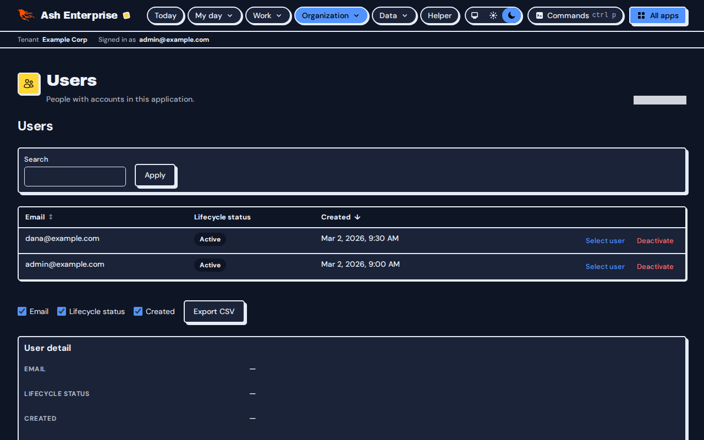
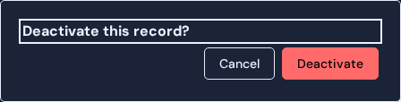
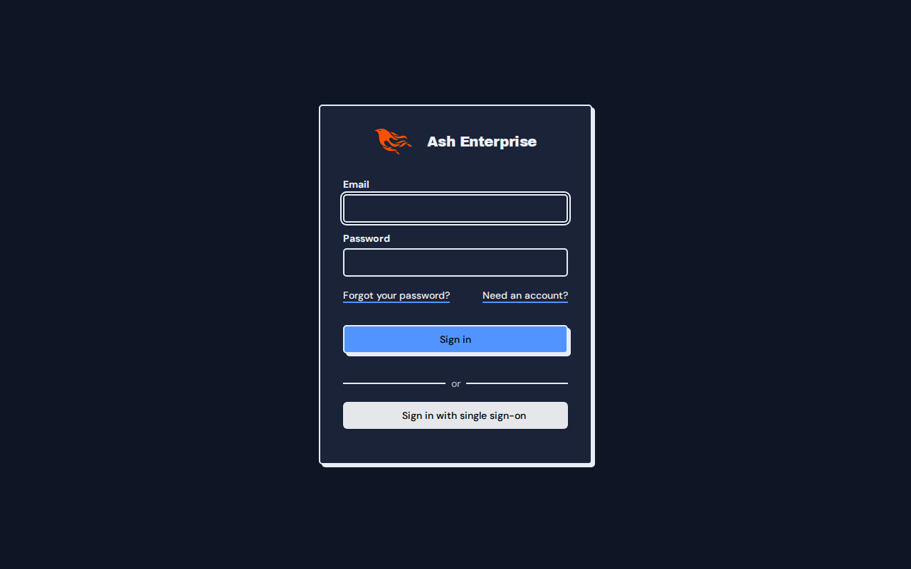

# Revoke a leaver's access

The person who is leaving can no longer use the app.

1. The person who is leaving is still signed in, with the app open.

2. Open **Users** and find the person who is leaving.

   

3. Choose **Deactivate** on their row, and confirm.

   

   

   > [!WARNING]
   > The next thing they do in the app sends them to sign in.

4. The next time they open the app, they are sent to sign in.

   

Their account is inactive, and the next thing they do in the app sends them to sign in.
