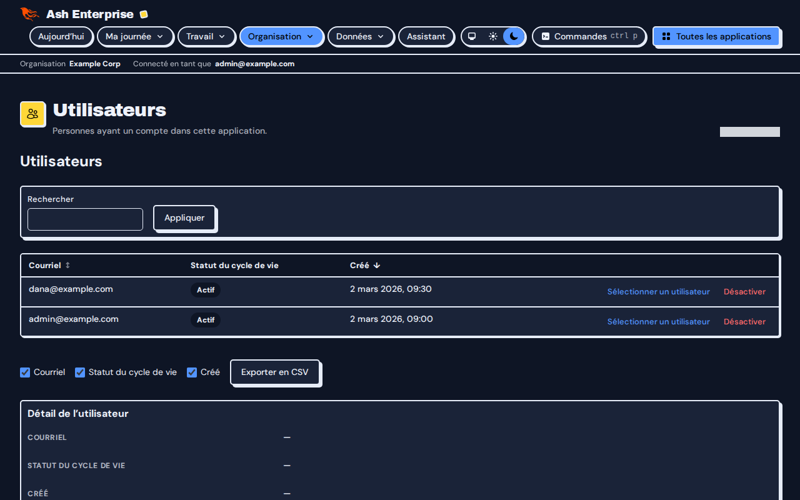
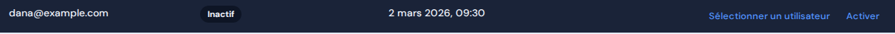

# Révoquer l'accès d'une personne qui s'en va

La personne qui s'en va ne peut plus utiliser l'application.

1. La personne qui s'en va est toujours connectée, avec l'application ouverte.

2. Ouvrez **Utilisateurs** et trouvez la personne qui s'en va.

   

3. Choisissez **Désactiver** sur sa ligne, puis confirmez.

   

   

   > [!WARNING]
   > Sa prochaine action dans l'application la renvoie vers la page de connexion.

4. La prochaine fois que cette personne ouvre l'application, elle est renvoyée vers la page de connexion.

   

Son compte est inactif, et sa prochaine action dans l'application la renvoie vers la page de connexion.
